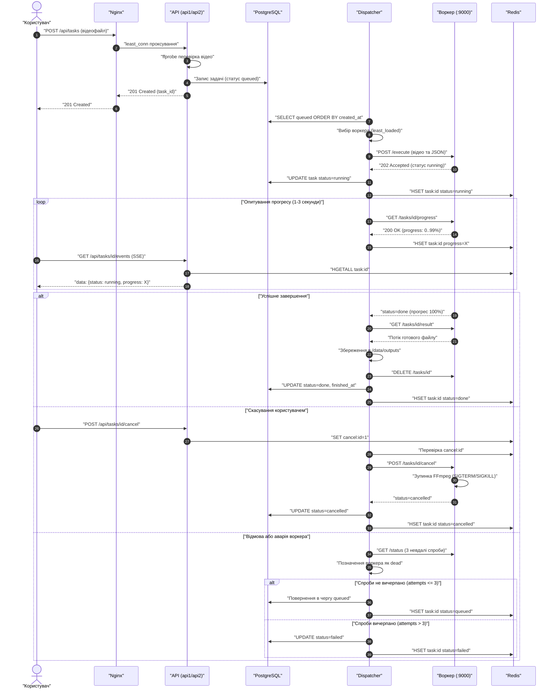
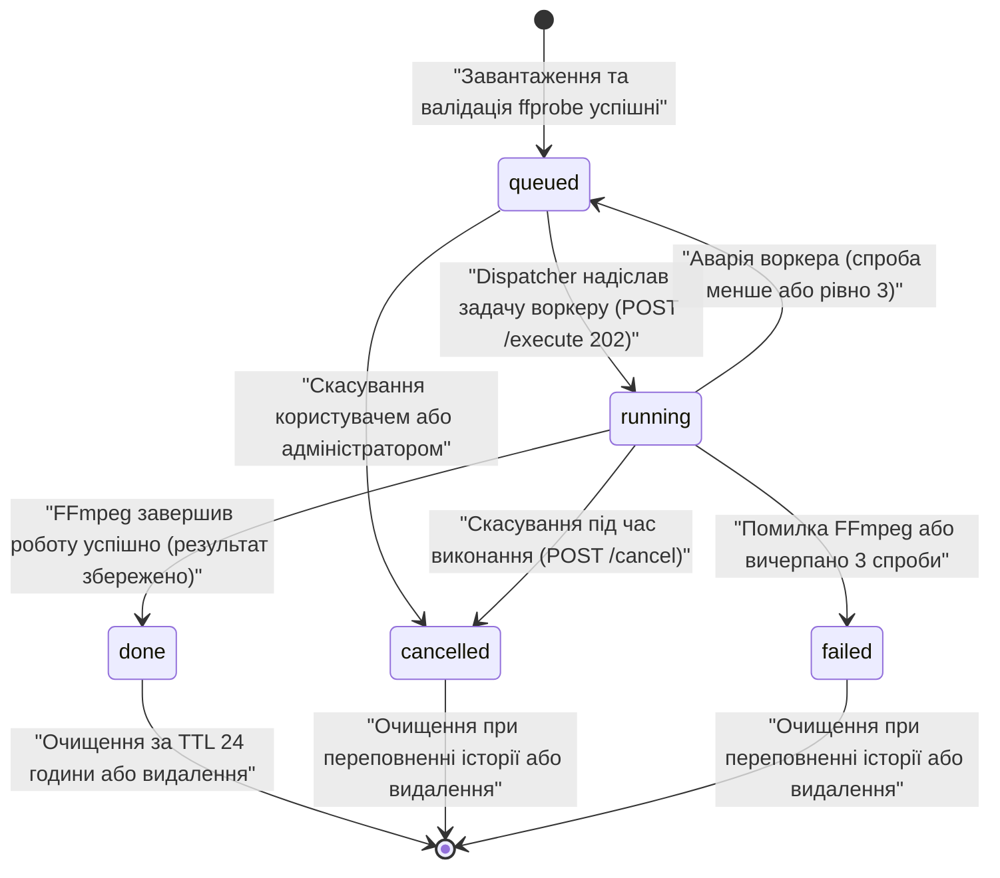

# Cloud Video Processor (CVP)

Розподілений хмарний сервіс пакетної обробки відео із високою доступністю, централізованою диспетчеризацією завдань, динамічним автомасштабуванням та моніторингом у реальному часі.

Побудовано на базі **FastAPI**, **Nginx** (зворотний проксі, термінація TLS, балансування `least_conn` та захист від брутфорсу), **Dispatcher** (push-балансувальник задач по мережі), **Worker Server** (повністю ізольовані мережеві HTTP-сервери кодування FFmpeg), **PostgreSQL** та **Redis**. Обробка мультимедіа здійснюється асинхронно з передачею живого прогресу в браузер через **Server-Sent Events (SSE)**.

---

## 1. Головні можливості

- **Багатофункціональна обробка відео:**
  - *Конвертація:* перекодування у формат MP4 (кодеки H.264 / AAC) із вибором пресету швидкості (`ultrafast` ... `veryslow`).
  - *Масштабування (Scale):* зміна роздільної здатності на `1080p`, `720p`, `480p`, `360p` з автоматичним підбором CRF-коефіцієнта якості.
  - *Водяний знак (Watermark):* накладання PNG-логотипа з гнучким вибором позиції (правий нижній, лівий верхній кут, центр тощо) та прозорості (opacity від 0.0 до 1.0).
  - *Робота з аудіо:* вилучення звукової доріжки у формат MP3 (`extract_audio`) або повне приглушення звуку без перекодування відеопотоку (`mute_audio`, `-c:v copy -an`).
- **Дворівневе балансування навантаження:**
  - Nginx розподіляє клієнтські HTTP-запити між екземплярами `api1` та `api2` за алгоритмом `least_conn`.
  - Dispatcher самостійно обирає виконавця серед пулу воркерів за алгоритмом `least_loaded` або `round_robin` і передає задачу з файлом через HTTP.
- **Ізольовані воркери без доступу до БД (Zero-Trust):**
  - Воркер-сервери не мають доступу до PostgreSQL, Redis чи спільного файлового тому `/data`.
  - Можливість підключення зовнішніх воркерів на окремих фізичних машинах або GPU-інстансах.
- **Моніторинг прогресу в реальному часі:**
  - Передача прогресу обробки (0..100%) у браузер клієнта через Server-Sent Events (SSE) без перезавантаження сторінки.
  - Оцінка позиції в черзі та динамічного часу очікування (ETA) для нових задач.
- **Автомасштабування (Autoscaler):**
  - Демон аналізує довжину черги в базі даних і динамічно запускає/зупиняє контейнери воркерів через Docker SDK у діапазоні 2..4 екземпляри.
- **Панель адміністратора:**
  - Централізований моніторинг інфраструктури, живі показники CPU/RAM воркерів (Heartbeat), журнал розподілу задач (Dispatcher Log), аудит автомасштабування та можливість скасування будь-якої задачі.
- **Автоматичне очищення (Cleanup):**
  - Завершення терміну життя результатів (TTL 24 години) та фонове видалення прострочених файлів кожні 10 хвилин.

---

## 2. Відповідність вимогам завдання

| № | Вимога завдання | Як реалізовано в системі | Де в коді |
| :-: | :--- | :--- | :--- |
| **1** | Завантаження відео та вхідна валідація | Потокове збереження з лімітом 100 МБ. Валідація `ffprobe`: наявність відеопотоку, тривалість <= 120 с, роздільна здатність <= 1080p, дозволені розширення (`.mp4`, `.mov`, `.mkv`, `.webm`, `.avi`). Валідація PNG-логотипа через Pillow (розмір <= 2 МБ). Безпечні UUID-імена. | `backend/app/routers/tasks.py` (`create_task`), `backend/app/services/probe.py` |
| **2** | Чотири операції обробки відео | Реалізовано конвертацію (H.264), масштабування (1080/720/480/360p), накладання водяного знака (PNG, 5 позицій, прозорість), роботу з аудіо (витягнення MP3, приглушення). Аргументи формуються списком без shell, прапорець `-protocol_whitelist file`. | `backend/worker_server/ffmpeg_runner.py` (`build_ffmpeg_args`, `run_ffmpeg`) |
| **3** | Асинхронність та живий прогрес (SSE) | Задачі реєструються як `queued`. Dispatcher передає задачу воркеру, опитує прогрес і пише в Redis (`task:{id}`). Клієнт отримує потік SSE щосекунди. | `backend/app/routers/tasks.py` (`events`), `backend/dispatcher/main.py` (`monitor_cycle`) |
| **4** | Збереження та скачування результату, TTL | Dispatcher забирає результат у `/data/outputs/{id}.{ext}`. Ендпоінт `download` перевіряє права, статус `done` та TTL (24 год). Періодичний фоновий демон кожні 10 хв очищає прострочені файли. | `backend/app/routers/tasks.py` (`download_task`), `backend/app/services/cleanup.py`, `backend/app/main.py` (`periodic_cleanup_loop`) |
| **5** | Автентифікація, безпека та ліміти | Хешування паролів Argon2. JWT-токен у cookie (`HttpOnly`, `Secure`, `SameSite=Lax`). Nginx `limit_req` 5 r/s (burst 10). Ізоляція задач за `user_id`. Ліміт 5 активних задач на користувача. | `backend/app/services/security.py`, `backend/app/routers/auth.py`, `nginx/nginx.conf` |
| **6** | Черга, позиція та динамічний ETA *(Бонус)* | Глобальна черга `queued` у PostgreSQL (макс. 100 задач). Обчислення місця в черзі та динамічного часу очікування (ETA) на основі поточної швидкості системи та місткості воркерів. Автоочищення історії користувача (>20 задач). | `backend/app/services/estimation.py` (`get_queue_position`, `estimate_wait_sec`), `backend/app/routers/tasks.py` |
| **7** | Heartbeat та автомасштабування *(Бонус)* | Воркери шлють метрики CPU/RAM/задач у Redis (`hb:{worker_id}`, TTL 10 с). Демон Autoscaler моніторить чергу в БД і масштабує контейнери воркерів від 2 до 4 через Docker SDK. | `backend/autoscaler/scaler.py`, `backend/autoscaler/main.py`, `backend/dispatcher/main.py` (`health_check_cycle`) |
| **8** | Панель адміністратора та моніторинг *(Бонус)* | Дашборд `/api/admin/overview`: статистика статусів, активні воркери з живими метриками, журнал Dispatcher Log, аудит Autoscaler, скасування будь-яких задач, ручний запуск очищення. | `backend/app/routers/admin.py`, `backend/dispatcher/main.py` (`log_dispatch_event`) |

---

## 3. Архітектура системи

### 3.1 Схема взаємодії компонентів

```mermaid
flowchart TB
    subgraph CLIENT["Клієнтський рівень"]
        Browser["Браузер React 19, TypeScript"]
    end

    subgraph PROXY["Рівень маршрутизації"]
        Nginx["Nginx Reverse Proxy TLS 1.2 і 1.3"]
    end

    subgraph API_CLUSTER["Кластер API Stateless"]
        API1["api1 FastAPI, Uvicorn"]
        API2["api2 FastAPI, Uvicorn"]
    end

    subgraph CORE_STATE["Спільний стан Лише API та Dispatcher"]
        PG[("PostgreSQL 16 Черга queued та задачі")]
        Redis[("Redis 7 Прогрес, скасування, логи")]
        Storage["Спільний том data uploads та outputs"]
    end

    subgraph DISPATCHER_LAYER["Рівень диспетчеризації"]
        Dispatcher["Dispatcher Daemon 1 екземпляр"]
    end

    subgraph WORKER_POOL["Ізольовані HTTP-воркери порт 9000"]
        W1["worker-1 FastAPI та FFmpeg"]
        W2["worker-2 FastAPI та FFmpeg"]
        WN["worker-remote Віддалена машина"]
    end

    subgraph AUTOSCALING["Рівень автомасштабування"]
        Autoscaler["Autoscaler Daemon Docker SDK"]
    end

    Browser -->|"HTTPS запити порт 443"| Nginx
    Nginx -->|"Балансування least_conn"| API1
    Nginx -->|"Балансування least_conn"| API2

    API1 -->|"Створення queued задач"| PG
    API2 -->|"Створення queued задач"| PG
    API1 -->|"Збереження uploads"| Storage
    API2 -->|"Збереження uploads"| Storage
    API1 -->|"Читання прогресу task:id"| Redis
    API2 -->|"Читання прогресу task:id"| Redis

    Dispatcher -->|"Опитування черги queued"| PG
    Dispatcher -->|"Читання uploads та запис outputs"| Storage
    Dispatcher -->|"Оновлення прогресу та логи"| Redis

    Dispatcher -->|"HTTP POST /execute стрімінг файлу"| W1
    Dispatcher -->|"HTTP POST /execute стрімінг файлу"| W2
    Dispatcher -->|"HTTP POST /execute стрімінг файлу"| WN

    W1 -->|"HTTP GET progress та result"| Dispatcher
    W2 -->|"HTTP GET progress та result"| Dispatcher
    WN -->|"HTTP GET progress та result"| Dispatcher

    W1 -.->|"Самореєстрація та heartbeat"| Dispatcher
    W2 -.->|"Самореєстрація та heartbeat"| Dispatcher
    WN -.->|"Самореєстрація та heartbeat"| Dispatcher

    Autoscaler -.->|"Опитування кількості queued"| PG
    Autoscaler -->|"Масштабування контейнерів воркерів"| WORKER_POOL

    classDef app fill:#EEEDFE,stroke:#534AB7,color:#3C3489
    classDef state fill:#E1F5EE,stroke:#0F6E56,color:#085041
    class Browser,Nginx,API1,API2,Dispatcher,W1,W2,WN,Autoscaler app
    class PG,Redis,Storage state
```



### 3.2 Два рівні балансування

1. **Перший рівень (Клієнтський HTTP-трафік):**
   - **Nginx Ingress** приймає всі вхідні з'єднання браузера по HTTPS (порт 443, сертифікат TLS 1.2 / 1.3).
   - Директива `upstream backend_servers` використовує алгоритм `least_conn` для розподілу HTTP-запитів між двома stateless-серверами `api1:8000` та `api2:8000`. У разі збою одного сервера Nginx прозоро перенаправляє запит на інший (`proxy_next_upstream`).
2. **Другий рівень (Обчислювальні задачі обробки):**
   - Служба **Dispatcher** (єдиний екземпляр) періодично вибирає задачі зі статусом `queued` із PostgreSQL і розподіляє їх між зареєстрованими воркер-серверами за алгоритмом `least_loaded` (або `round_robin`).

### 3.3 Чому HTTP Push через Dispatcher, а не черга брокера (Celery)

- **Мережева ізоляція (Zero-Trust):** У традиційній pull-моделі (Celery) воркери мусять мати прямий доступ до брокера (Redis), бази даних та спільного диску (NFS/Docker volume). У новій архітектурі **воркер — це ізольований HTTP-сервер**. Йому не потрібні паролі до бази даних чи Redis.
- **Підтримка віддалених вузлів:** Воркер може виконуватися на будь-якому комп'ютері чи GPU-сервері в іншій мережі; Dispatcher передає файл безпосередньо по HTTP.
- **Централізований контроль кластера:** Dispatcher знає реальне завантаження кожного воркера (CPU, RAM, активні задачі) та свідомо направляє нові файли на найменш завантажені вузли, запобігаючи нерівномірному перевантаженню.

---

## 4. Життєвий цикл задачі

### 4.1 Діаграма послідовності (Sequence Diagram)



### 4.2 Діаграма станів (State Diagram)



### 4.3 Покроковий опис із назвами функцій коду

1. **Завантаження та валідація:** Клієнт викликає `POST /api/tasks` (`create_task` у `backend/app/routers/tasks.py`). Файл потоково записується на диск, валідується функцією `probe_video` (`backend/app/services/probe.py`). При успіху створюється запис у БД зі статусом `TaskStatus.queued`.
2. **Вибірка черги:** У фоновому циклі Dispatcher `dispatch_cycle` (`backend/dispatcher/main.py`) функція `get_queued_tasks_sync` зчитує задачі зі статусом `queued`.
3. **Вибір воркера:** Метод `strategy.select_worker(candidates)` (`LeastLoadedStrategy` у `backend/dispatcher/strategies.py`) обирає воркера з мінімальним завантаженням.
4. **Мережева передача задачі:** Dispatcher через `worker_client.execute` викликає `POST /execute` на воркер-сервері (`execute_task` у `backend/worker_server/main.py`), потоково надсилаючи відеофайл. Воркер валідує UUID, вільне місце на диску, виділяє слот і повертає `202 Accepted`.
5. **Запуск FFmpeg:** Воркер викликає `_execute_processing_sync` у фоновому потоці ОС. Функція `build_ffmpeg_args` формує аргументи, а `run_ffmpeg` (`backend/worker_server/ffmpeg_runner.py`) запускає процес кодування.
6. **Опитування прогресу:** Dispatcher у циклі `monitor_cycle` опитує `worker_client.get_progress` (`GET /tasks/{task_id}/progress`) і записує прогрес 0..99% у Redis (`r.hset f"task:{task_id}"`).
7. **SSE-трансляція:** Браузер тримає відкрите з'єднання `GET /api/tasks/{task_id}/events` (`events` у `tasks.py`), щосекунди читаючи стан із Redis і надсилаючи клієнту SSE-подію.
8. **Отримання результату:** При статусі `done` Dispatcher викликає `worker_client.download_result` (`GET /tasks/{task_id}/result`), зберігає файл у `/data/outputs/{task_id}{ext}`, надсилає воркеру `worker_client.delete_task` (`DELETE /tasks/{task_id}`) та оновлює статус у базі даних на `done` (`update_done_sync`).

---

## 5. Технологічний стек

| Компонент | Технологія | Реальна версія | Призначення в системі |
| :--- | :--- | :--- | :--- |
| **Базовий образ Backend** | Python / Debian Slim | `3.12-slim` | Легковаговий образ із попередньо встановленим пакетом `ffmpeg` |
| **Веб-фреймворк API / Dispatcher / Worker** | FastAPI / Starlette | `fastapi >= 0.115` | Високопродуктивний асинхронний REST API, валідація типів Pydantic |
| **ASGI веб-сервер** | Uvicorn | `uvicorn >= 0.32` | Асинхронний запуск FastAPI застосунків на портах 8000, 8100, 9000 |
| **Реляційна СУБД** | PostgreSQL | `16` | Персистентне збереження облікових записів, ролей, історії задач та черги |
| **ORM та міграції** | SQLAlchemy / Alembic | `sqlalchemy`, `alembic` | Схеми таблиць, пул з'єднань, виконання міграцій при старті кластера |
| **Швидка пам'ять та кеш** | Redis | `7` | Прогрес задач, прапорці скасування, heartbeat воркерів, оперативні логи |
| **Обробка медіа** | FFmpeg / ffprobe | Офіційний пакет Debian | Перекодування відео, вилучення звуку, накладання логотипа, валідація |
| **Клієнтський веб-інтерфейс** | React / TypeScript | `React ^19.3.1`, `TS ~6.0.3` | Реактивний SPA-інтерфейс, SSE-відстеження, адмін-панель |
| **Збирач фронтенду** | Vite | `^8.3.4` | Швидка компіляція TypeScript та оптимізація статичних асетів у `dist/` |
| **CSS-фреймворк** | Pico CSS | `@picocss/pico ^2.1.1` | Семантичний мінімалістичний дизайн вебінтерфейсу |
| **HTTP-клієнт Python** | HTTPX | `httpx >= 0.27` | Асинхронний стрімінг файлів між Dispatcher та Worker Server |
| **Зворотний проксі / Ingress** | Nginx | `nginx:alpine` | Термінація TLS 1.2/1.3, балансування `least_conn`, `limit_req`, роздача SPA |
| **Керування контейнерами** | Docker SDK for Python | `docker >= 7.0` | Динамічне створення та зупинка воркерів службою Autoscaler |
| **Безпека та паролі** | Argon2 / PyJWT | `argon2-cffi`, `pyjwt` | Хешування паролів стійким алгоритмом Argon2id, підпис JWT-токенів |

---

## 6. Структура репозиторію

```text
Cloud-video-processor/
├── .env.example                  # Зразок змінних середовища для всього кластера
├── docker-compose.yml            # Оркестрація контейнерів (postgres, redis, api, dispatcher, worker, autoscaler, nginx)
├── localhost.crt                 # SSL-сертифікат для встановлення у довірені центри ОС
├── locustfile.py                 # Сценарій навантажувального тестування Locust
├── backend/
│   ├── Dockerfile                # Базовий Dockerfile на базі python:3.12-slim з FFmpeg
│   ├── requirements.txt          # Python-залежності бекенду
│   ├── alembic.ini               # Конфігурація мігратора Alembic
│   ├── alembic/                  # Скрипти міграцій БД (0001_initial_tables.py)
│   ├── app/                      # Stateless REST API сервіс
│   │   ├── config.py             # Налаштування pydantic-settings
│   │   ├── db.py                 # Підключення до PostgreSQL (SessionLocal)
│   │   ├── main.py               # Точка входу API, реєстрація роутерів, фонове очищення
│   │   ├── models.py             # SQLAlchemy-моделі (User, Task, TaskStatus)
│   │   ├── schemas.py            # Pydantic-схеми запитів та відповідей
│   │   ├── routers/              # Ендпоінти: auth, tasks, admin, autoscaler
│   │   └── services/             # Логіка: probe (ffprobe), cleanup, estimation, security
│   ├── dispatcher/               # Служба координації задач (Dispatcher Daemon)
│   │   ├── client.py             # HTTPX-клієнт зв'язку з воркерами
│   │   ├── main.py               # Диспетчеризація, моніторинг, обробка збоїв, API порту 8100
│   │   ├── registry.py           # Реєстр активних воркерів та їх метрик
│   │   └── strategies.py         # Алгоритми балансування (LeastLoaded, RoundRobin)
│   ├── worker_server/            # Автономний мережевий воркер-сервер (порт 9000)
│   │   ├── ffmpeg_runner.py      # Безпечний запуск процесу FFmpeg, парсинг прогресу, таймаути
│   │   └── main.py               # FastAPI застосунок воркера, локальний диск, самореєстрація
│   ├── autoscaler/               # Демон автоматичного масштабування воркерів
│   │   ├── main.py               # Точка входу демона Autoscaler
│   │   └── scaler.py             # Логіка підрахунку черги та викликів Docker SDK
│   └── tests/                    # Набір 89 автоматичних unit та integration тестів
├── frontend/
│   ├── package.json              # Залежності React 19, TypeScript, Vite
│   ├── vite.config.ts            # Налаштування збірки Vite
│   ├── src/                      # Вихідний код SPA: компоненти, App.tsx, CSS
│   └── dist/                     # Скомпільовані статичні файли для роздачі через Nginx
├── nginx/
│   ├── nginx.conf                # Конфігурація зворотного проксі, upstream, SSL, limit_req
│   └── certs/                    # Локальні сертифікати (localhost.pem, localhost-key.pem)
├── demo_videos/                  # Набір тестових медіафайлів для демонстрації та валідації
├── docs/
│   ├── architecture.md           # Детальний опис архітектури з трьома Mermaid-діаграмами
│   ├── demo.md                   # Покроковий сценарій демонстрації та захисту проєкту
│   └── evidence/                 # Звіти та графіки навантажувального тестування
└── scripts/
    ├── benchmark_workers.py      # Скрипт автоматизованого запуску Locust
    ├── plot_locust_results.py    # Побудова графіків порівняння Locust
    ├── record_balancing.py       # Фіксація розподілу запитів Nginx
    └── trigger_cluster_load.py   # Генерація навантаження черги для перевірки Autoscaler
```

---

## 7. Швидкий старт

### 7.1 Передумови

- **Docker Desktop** (версія 24+ з увімкненим Compose V2).
- **Node.js** (версія 18+ для збірки вебінтерфейсу).
- **Python 3.10+** (необхідний для локального запуску тестів або допоміжних скриптів).

---

### 7.2 Покрокова інструкція запуску

#### Крок 1. Підготовка конфігурації `.env`
Скопіюйте зразок конфігураційного файлу:
```bash
# Windows PowerShell або Bash:
cp .env.example .env
```

> [!IMPORTANT]
> **Обов'язково згенеруйте надійний криптографічний токен для воркерів:**
> ```bash
> python -c "import secrets; print(secrets.token_hex(32))"
> ```
> Відкрийте створений файл `.env` і замініть значення `WORKER_TOKEN` на згенерований рядок. Також замініть стандартні значення `JWT_SECRET` та `ADMIN_PASSWORD`.

#### Крок 2. Збірка клієнтського вебінтерфейсу
Nginx монтує директорію `frontend/dist`. Якщо її не зібрати, сайт повертатиме порожню сторінку:
```bash
# Встановлення NPM-залежностей:
npm --prefix frontend install

# Компіляція TypeScript та збірка Vite у каталог frontend/dist:
npm --prefix frontend run build
```

#### Крок 3. Запуск сервісів через Docker Compose
Кластер запускається з пулом із двох воркерів (`--scale worker=2`), що забезпечує мінімальну конфігурацію відмовостійкості та балансування:
```bash
docker compose up --build -d --scale worker=2
```
*(Якщо опустити прапорець `--scale worker=2`, стартує лише один екземпляр воркера).*

#### Крок 4. Перевірка статусу та реєстрації воркерів
Переконайтеся, що всі сервіси перебувають у статусі `Up`:
```bash
docker compose ps
```
*(Сервіс `migrate` штатно завершує роботу зі статусом `Exited (0)` після накатування міграцій бази даних — це очікувана правильна поведінка).*

Перевірте логи координатора Dispatcher:
```bash
docker compose logs dispatcher
```
У логах мають з'явитися рядки про успішну реєстрацію воркерів:
`Registered worker ... at http://...:9000 (capacity=1)`.

Також можна перевірити зареєстрованих воркерів через внутрішній API Dispatcher:
```bash
# Запит із хост-машини (замініть YOUR_WORKER_TOKEN на токен із .env):
curl -H "X-Worker-Token: YOUR_WORKER_TOKEN" http://127.0.0.1:8100/internal/workers
```

#### Крок 5. Доступ до системи
- **Вебінтерфейс:** [https://localhost](https://localhost)
- **Інтерактивна документація Swagger:** [https://localhost/docs](https://localhost/docs)
- **ReDoc документація:** [https://localhost/redoc](https://localhost/redoc)
- **Облікові дані адміністратора за замовчуванням:**
  - **Email:** `admin@example.com`
  - **Пароль:** `admin_password_123`

#### Крок 6. Довірений SSL-сертифікат (за бажанням)
Проєкт містить самопідписаний сертифікат для домену `localhost`. Щоб прибрати попередження безпеки у браузері:
- **У Windows PowerShell (від імені адміністратора):**
  ```powershell
  certutil -user -addstore Root nginx\certs\localhost.pem
  ```
- Повністю перезапустіть браузер.

#### Крок 7. Зупинка та скидання даних
- **Звичайна зупинка контейнерів:**
  ```bash
  docker compose down
  ```
- **Повне скидання (разом із базою даних і збереженими відео у томах):**
  ```bash
  docker compose down -v
  ```

---

## 8. Конфігурація змінних середовища

Усі змінні зчитуються з файлу `.env` через модуль `pydantic-settings` (`backend/app/config.py`).

| Змінна середовища | Значення за замовчуванням | Опис та призначення |
| :--- | :---: | :--- |
| `DB_USER` | `cvp` | Користувач бази даних PostgreSQL |
| `DB_PASSWORD` | `my_secret_password` | Пароль користувача бази даних |
| `DB_NAME` | `cvp` | Назва бази даних |
| `DB_HOST` | `postgres` | Хост для з'єднання з БД всередині мережі Docker |
| `DB_PORT` | `5432` | Порт PostgreSQL всередині мережі |
| `DB_HOST_PORT` | `5433` | Зовнішній порт PostgreSQL, що прокидається на хост |
| `REDIS_HOST` | `redis` | Хост сервера Redis |
| `REDIS_PORT` | `6379` | Порт сервера Redis |
| `REDIS_DB` | `0` | Номер логічної бази даних Redis |
| `JWT_SECRET` | `super_secure_jwt_secret_key_12345` | Секретний ключ для підпису JWT-токенів (HS256) |
| `JWT_ALGORITHM` | `HS256` | Алгоритм шифрування підпису JWT |
| `JWT_EXPIRE_MINUTES` | `60` | Термін дії JWT-токена в хвилинах |
| `COOKIE_SECURE` | `True` | Прапорець Secure для cookie (передача лише по HTTPS) |
| `COOKIE_SAMESITE` | `lax` | Політика SameSite для захисту від CSRF |
| `ADMIN_EMAIL` | `admin@example.com` | Email автоматично створеного адміністратора |
| `ADMIN_PASSWORD` | `admin_password_123` | Пароль автоматично створеного адміністратора |
| `MAX_FILE_MB` | `100` | Максимальний розмір вхідного відеофайлу (МБ) |
| `MAX_DURATION_SEC` | `120` | Максимальна тривалість відео (секунди) |
| `MAX_ACTIVE_TASKS` | `5` | Максимальна кількість активних задач одного користувача |
| `MAX_HISTORY` | `20` | Максимальна кількість збережених завершених задач |
| `MAX_QUEUE` | `100` | Максимальний ліміт задач у черзі кластера |
| `RESULT_LIFETIME_HOURS` | `24` | Час життя готового результату для завантаження (години) |
| `WORKER_TOKEN` | `super_secret_worker_token` | **Критично:** спільний секретний токен для викликів воркера та реєстрації |
| `DISPATCHER_URL` | `http://dispatcher:8100` | **Критично:** URL координатора для реєстрації воркерів |
| `BALANCING_STRATEGY` | `least_loaded` | Алгоритм балансування Dispatcher (`least_loaded` або `round_robin`) |
| `WORKER_CAPACITY` | `1` | Кількість одночасних задач на один воркер |
| `DISPATCH_INTERVAL` | `1.0` | Інтервал опитування черги координатором (секунди) |
| `WORKER_POLL_INTERVAL` | `3.0` | Інтервал перевірки життєздатності воркерів Dispatcher (секунди) |
| `WORKER_FAIL_THRESHOLD` | `3` | Кількість невдалих опитувань, після яких воркер вважається `dead` |
| `MAX_TASK_ATTEMPTS` | `3` | Максимальна кількість спроб перезапуску задачі при падіннях воркера |
| `TASK_TIMEOUT_SEC` | `300` | Максимальний час виконання процесу FFmpeg на воркері (секунди) |
| `MIN_WORKERS` | `2` | Мінімальна кількість контейнерів воркерів для Autoscaler |
| `MAX_WORKERS` | `4` | Максимальна кількість контейнерів воркерів для Autoscaler |
| `PER_WORKER` | `1` *(в compose)* | Поріг черги для запуску нового воркера (`queued > n * PER_WORKER`) |
| `IDLE_FOR` | `30` *(в compose)* | Час простою у секундах до зупинки зайвого автомасштабованого воркера |
| `DOCKER_NETWORK` | `cloud-video-processor_default` | Назва мережі Docker для запуску нових контейнерів воркерів |

> [!WARNING]
> Для успішної самореєстрації воркера у Dispatcher змінні `DISPATCHER_URL` та `WORKER_TOKEN` обов'язково повинні збігатися у конфігураціях обох сервісів.

---

## 9. Системні ліміти та обмеження

Усі обмеження суворо перевіряються в коді:

| Параметр ліміту | Значення | Код помилки при перевищенні | Пояснення перевірки |
| :--- | :---: | :---: | :--- |
| **Максимальний розмір відео** | **100 МБ** | `422 Unprocessable Content` | Перевіряється під час потокового запису чанками по 1 МБ |
| **Максимальна тривалість** | **120 секунд** | `422 Unprocessable Content` | Перевіряється утилітою `ffprobe` перед постановкою в чергу |
| **Максимальна роздільна здатність** | **1920×1080 (Full HD)** | `422 Unprocessable Content` | Перевіряється `ffprobe` (ширина <= 1920 і висота <= 1080) |
| **Дозволені формати відео** | `.mp4, .mov, .mkv, .webm, .avi` | `422 Unprocessable Content` | Файл обов'язково повинен містити валідний відеопотік |
| **Водяний знак (логотип)** | **PNG <= 2 МБ** | `422 Unprocessable Content` | Перевіряється бібліотекою Pillow (`img.verify()`, формат PNG) |
| **Активні задачі користувача** | **Максимум 5** | `429 Too Many Requests` | Сума задач користувача зі статусами `queued` та `running` |
| **Глобальна черга кластера** | **Максимум 100** | `503 Service Unavailable` | Загальна кількість `queued` задач у БД (`Retry-After: 30`) |
| **Історія задач користувача** | **Максимум 20** | Авто-видалення найстаріших | При створенні 21-ї задачі найстаріші завершені задачі видаляються |
| **Час життя результату (TTL)** | **24 години** | `410 Gone` | `expires_at = finished_at + 24h`, після чого завантаження блокується |
| **Мінімальне місце на диску** | **50 МБ** | `507 Insufficient Storage` | Перевіряється на хості завантаження та на локальному диску воркера |
| **Таймаут обробки задачі** | **300 секунд (5 хв)** | `failed` (TimeoutError) | Воркер примусово зупиняє FFmpeg (`terminate` -> `kill`) |
| **Частота запитів авторизації** | **5 req/s (burst 10)** | `429 Too Many Requests` | Зона пам'яті Nginx `limit_req` на маршрутах `/api/auth/` |

---

## 10. Специфікація API

### 10.1 Клієнтське API користувача (порт 443 / 8000)

| Метод | Маршрут | Авторизація | Опис дії | Коди відповідей |
| :--- | :--- | :---: | :--- | :---: |
| `POST` | `/api/auth/register` | Ні | Реєстрація нового користувача, встановлення JWT cookie | `201`, `400`, `422` |
| `POST` | `/api/auth/login` | Ні | Вхід за email/паролем, встановлення `HttpOnly` JWT cookie | `200`, `401`, `429` |
| `POST` | `/api/auth/logout` | Cookie | Очищення авторизаційного cookie | `200` |
| `GET` | `/api/auth/me` | Cookie | Отримання профілю поточного користувача | `200`, `401` |
| `POST` | `/api/tasks` | Cookie | Завантаження відео та постановка в чергу `queued` | `201`, `422`, `429`, `503`, `507` |
| `GET` | `/api/tasks` | Cookie | Список задач поточного користувача з позицією в черзі | `200`, `401` |
| `GET` | `/api/tasks/{id}` | Cookie | Деталі конкретної задачі (з перевіркою власника) | `200`, `403`, `404` |
| `GET` | `/api/tasks/{id}/events` | Cookie | Server-Sent Events (SSE) живий стрім прогресу | `200` (text/event-stream) |
| `GET` | `/api/tasks/{id}/download` | Cookie | Завантаження готового обробленого медіафайлу | `200`, `400`, `404`, `410` |
| `POST` | `/api/tasks/{id}/cancel` | Cookie | Скасування активної задачі (черга або виконання) | `200`, `400`, `403`, `404` |
| `DELETE`| `/api/tasks/{id}` | Cookie | Видалення задачі та пов'язаних файлів із диска | `200`, `404` |
| `GET` | `/api/health` | Ні | Перевірка працездатності API, повертає `X-Served-By` | `200` |

### 10.2 Адміністративне API (порт 443 / 8000)

| Метод | Маршрут | Авторизація | Опис дії | Коди відповідей |
| :--- | :--- | :---: | :--- | :---: |
| `GET` | `/api/admin/overview` | Admin Cookie | Зведена статистика, метрики воркерів, останні 50 задач, логи | `200`, `401`, `403` |
| `POST` | `/api/admin/tasks/{id}/cancel` | Admin Cookie | Примусове скасування будь-якої задачі кластера | `200`, `400`, `404` |
| `POST` | `/api/admin/cleanup` | Admin Cookie | Негайне видалення прострочених задач і файлів | `200`, `403` |
| `GET` | `/api/admin/check` | Admin Cookie | Перевірка наявності адміністративних прав | `200`, `403` |
| `GET` | `/api/autoscaler/status` | Cookie | Поточний стан автомасштабування та події | `200`, `401` |

### 10.3 Внутрішнє API координатора Dispatcher (порт 8100)

| Метод | Маршрут | Авторизація | Опис дії | Коди відповідей |
| :--- | :--- | :---: | :--- | :---: |
| `GET` | `/health` | Ні | Перевірка стану служби Dispatcher | `200` |
| `POST` | `/internal/workers/register` | `X-Worker-Token` | Самореєстрація воркера або оновлення heartbeat | `200`, `401` |
| `POST` | `/internal/workers/deregister` | `X-Worker-Token` | Коректне вилучення воркера з пулу при зупинці | `200`, `401` |
| `GET` | `/internal/workers` | `X-Worker-Token` | Список усіх зареєстрованих воркерів та їх метрик | `200`, `401` |

### 10.4 HTTP API воркер-сервера Worker Server (порт 9000)

| Метод | Маршрут | Авторизація | Опис дії | Коди відповідей |
| :--- | :--- | :---: | :--- | :---: |
| `GET` | `/health` | Ні | Перевірка стану воркер-сервера | `200` |
| `GET` | `/status` | `X-Worker-Token` | Метрики воркера (CPU%, RAM%, місткість, uptime, активні задачі) | `200`, `401` |
| `POST` | `/execute` | `X-Worker-Token` | Приймання задачі та стрімінг файлу, старт FFmpeg | `202`, `200` (idempotent), `422`, `503`, `507` |
| `GET` | `/tasks/{id}/progress` | `X-Worker-Token` | Отримання локального прогресу задачі (0..99%) | `200`, `404` |
| `POST` | `/tasks/{id}/cancel` | `X-Worker-Token` | Виставлення внутрішнього `threading.Event` для зупинки FFmpeg | `200`, `404` |
| `GET` | `/tasks/{id}/result` | `X-Worker-Token` | Скачування готового закодованого файлу після завершення | `200`, `404`, `409` |
| `DELETE`| `/tasks/{id}` | `X-Worker-Token` | Очищення локальних вхідних/вихідних файлів та пам'яті | `200` |

---

## 11. Балансування та масштабування

### 11.1 Nginx Ingress
- Конфігурація `upstream backend_servers` використовує алгоритм `least_conn`. Кожен новий HTTP-запит направляється до екземпляра API з найменшою кількістю активних TCP-з'єднань.
- Параметри `max_fails=3 fail_timeout=10s` гарантують, що тимчасово недоступний інстанс виключається з пулу на 10 секунд, а директива `proxy_next_upstream` повторює запит на здоровому сервері.
- Для маршруту `/api/` вимкнено проксі-буферизацію (`proxy_buffering off`), що забезпечує доставку подій Server-Sent Events клієнту без затримок.

### 11.2 Стратегії балансування задач Dispatcher
- **`least_loaded` (за замовчуванням):** обирає воркера з найменшим коефіцієнтом завантаження:
  $$\text{load\_ratio} = \frac{\text{len}(\text{active\_task\_ids})}{\max(1, \text{capacity})}$$
  Якщо коефіцієнти однакові, перевага надається воркеру з меншим використанням CPU, далі — за алфавітним порядком `worker_id`.
- **`round_robin`:** детермінована циклічна черговість серед усіх доступних воркерів із вільними слотами.

### 11.3 Механізм самореєстрації воркерів
1. При старті воркер у фоновому циклі надсилає `POST /internal/workers/register` із заголовком `X-Worker-Token`.
2. Якщо Dispatcher ще не готовий, воркер повторює спроби з експоненційною затримкою (від 1 до 10 с).
3. Після успішної реєстрації воркер продовжує надсилати запити кожні 10 секунд як підтвердження активності (heartbeat).
4. При отриманні сигналу завершення роботи (SIGTERM) воркер надсилає `POST /internal/workers/deregister` для миттєвого видалення з черги розподілу.

### 11.4 Динамічне автомасштабування (Autoscaler)
- Демон перевіряє довжину черги кожні 5 секунд (`AUTOSCALER_SLEEP=5`).
- **Масштабування вгору (Scale Up):** якщо кількість задач `queued > n * PER_WORKER` (де `n` — поточна кількість воркерів, `PER_WORKER=1`), Autoscaler запускає новий контейнер воркера через Docker Engine API (аж до `MAX_WORKERS=4`). Новий контейнер самореєструється в Dispatcher і одразу починає приймати задачі.
- **Масштабування вниз (Scale Down):** коли черга спорожніла (`queued == 0`), воркери з міткою `cvp.autoscaled="1"`, які не мають активних задач і перебувають у стані простою довше ніж `IDLE_FOR=30` секунд, автоматично зупиняються та видаляються (до базового мінімуму `MIN_WORKERS=2`).

---

## 12. Відмовостійкість та відновлення після аварій

| Подія / Збій | Реальний таймер у коді | Що відбувається в системі |
| :--- | :---: | :--- |
| **Воркер не відповідає на запити** | 3 опитування по 3.0 с (`WORKER_FAIL_THRESHOLD=3`) | Dispatcher фіксує 3 невдалі перевірки `/status`, позначає воркера як `dead`, видаляє його з реєстру та очищає його heartbeat у Redis (`hb:{id}`). |
| **Падіння воркера під час задачі** | Миттєво при фіксації `dead` або 404 | Dispatcher перехоплює втрату задачі, повертає її в чергу `queued`, обнуляє `worker_id` та збільшує лічильник спроб `attempts` у Redis. |
| **Перезапуск Dispatcher** | Під час запуску (`lifespan`) | Функція `recover_running_tasks_sync` сканує PostgreSQL, знаходить усі задачі зі статусом `running` і переводить їх назад у `queued` для повторного розподілу. |
| **Перезапуск воркера** | Після рестарту | Воркер запускається з чистою пам'яттю, автоматично реєструється в Dispatcher; якщо старі задачі були на ньому втрачені, Dispatcher зафіксує 404 і поверне їх у чергу. |
| **Скасування задачі в черзі** | Миттєво (< 1 с) | Ендпоінт `/cancel` миттєво змінює статус у БД та Redis на `cancelled`, задача не надсилається воркерам. |
| **Скасування активної задачі** | Перевірка кожні 0.5 с | Виставляється `cancel:{id}` у Redis, Dispatcher викликає `/cancel` на воркері, воркер виставляє `threading.Event`, зупиняє FFmpeg (`terminate` -> 5 с -> `kill`) і видаляє тимчасові файли. |
| **Помилка кодування FFmpeg** | Завершення процесу | Воркер зчитує stderr лог, фіксує статус `failed`, Dispatcher зберігає помилку в базі даних та звільняє слот. |
| **Вичерпання ліміту спроб** | Після 3 невдач (`MAX_TASK_ATTEMPTS=3`) | Задача переходить у фінальний статус `failed` із повідомленням `Task failed after exceeding 3 attempts: <reason>`. |

---

## 13. Заходи безпеки

- **Хешування паролів:** Argon2id через `argon2-cffi` із автоматичним генеруванням випадкової солі. Паролі ніколи не зберігаються у відкритому вигляді.
- **Безпечні JWT-сесії:** підпис `HS256`, обмежений термін дії (60 хв). Токен зберігається виключно в захищеному cookie з прапорцями:
  - `HttpOnly`: захист від XSS-атак (недоступний через JavaScript `document.cookie`);
  - `Secure`: передається виключно через HTTPS;
  - `SameSite=Lax`: захист від міжсайтової підробки запитів (CSRF).
- **Службовий токен воркерів:** усі ендпоінти Worker Server (крім `/health`) та внутрішні адреси Dispatcher захищені перевіркою заголовка `X-Worker-Token`.
- **Захист від брутфорсу:** Nginx обмежує запити до авторизації зоною `auth_limit` (5 запитів/с, сплеск до 10).
- **Вхідний контроль файлів через ffprobe:** обов'язкова перевірка перед прийняттям. Пошкоджені файли, файли без відеопотоку або з підробленими розширеннями негайно відхиляються з кодом 422 і видаляються з диску.
- **Безпечний запуск FFmpeg:**
  - Аргументи передаються виключно списком рядків без використання командної оболонки (`shell=False`), що повністю унеможливлює ін'єкцію shell-команд.
  - Директива `-protocol_whitelist file` забороняє FFmpeg відкривати зовнішні мережеві URL, сокети чи пайпи.
  - Пресети швидкості перевіряються за білим списком `ALLOWED_PRESETS`.
  - Значення прозорості водяного знака примусово конвертується у `float(0.0..1.0)`.
- **Ізоляція файлової системи:** імена файлів генеруються виключно як випадкові UUIDv4 (`{task_id}{safe_ext}`). Жодні оригінальні назви файлів користувача не використовуються на файловій системі сервера. Функція `_is_safe_data_path` перевіряє, що шляхи не виходять за межі дозволених каталогів (захист від Path Traversal).
- **Мережева ізоляція воркерів:** контейнери воркерів не мають облікових записів до PostgreSQL чи Redis і не монтують спільний том `/data`.

---

## 14. Запуск воркера на окремому комп'ютері

Завдяки HTTP-архітектурі воркер можна запустити на будь-якому віддаленому комп'ютері чи сервері без Docker Compose.

### Варіант А. Запуск через Python
```bash
# 1. Перейдіть у каталог backend на віддаленій машині
cd backend

# 2. Встановіть необхідні залежності та переконайтеся, що FFmpeg встановлено в системі
pip install -r requirements.txt

# 3. Задайте змінні середовища
# Linux / macOS:
export WORKER_ID=remote-worker-1
export WORKER_PORT=9000
export WORKER_CAPACITY=1
export WORKER_PUBLIC_URL=http://<REMOTE_WORKER_IP>:9000
export DISPATCHER_URL=http://<DISPATCHER_HOST_IP>:8100
export WORKER_TOKEN=YOUR_GENERATED_WORKER_TOKEN
export WORKER_DATA_DIR=/tmp/cvp-worker

# Windows PowerShell:
$env:WORKER_ID="remote-worker-1"
$env:WORKER_PORT="9000"
$env:WORKER_CAPACITY="1"
$env:WORKER_PUBLIC_URL="http://<REMOTE_WORKER_IP>:9000"
$env:DISPATCHER_URL="http://<DISPATCHER_HOST_IP>:8100"
$env:WORKER_TOKEN="YOUR_GENERATED_WORKER_TOKEN"
$env:WORKER_DATA_DIR="$env:TEMP\cvp-worker"

# 4. Запустіть сервер воркера
uvicorn worker_server.main:app --host 0.0.0.0 --port 9000
```

### Варіант Б. Запуск через Docker-контейнер
```bash
# Збірка образу воркера
docker build -t cvp-worker ./backend

# Запуск автономного контейнера
docker run -d \
  --name remote-worker \
  -p 9000:9000 \
  -e WORKER_ID=remote-worker-docker \
  -e WORKER_PORT=9000 \
  -e WORKER_CAPACITY=1 \
  -e WORKER_PUBLIC_URL=http://<REMOTE_WORKER_IP>:9000 \
  -e DISPATCHER_URL=http://<DISPATCHER_HOST_IP>:8100 \
  -e WORKER_TOKEN=YOUR_GENERATED_WORKER_TOKEN \
  cvp-worker uvicorn worker_server.main:app --host 0.0.0.0 --port 9000
```

> **Мережеві налаштування брандмауера:**
> - На хості Dispatcher порт `8100` має бути відкритий для вхідних TCP-з'єднань від воркера.
> - На хості воркера порт `9000` має бути відкритий для вхідних TCP-з'єднань від Dispatcher.
> - Перевірити реєстрацію можна запитом: `curl -H "X-Worker-Token: <TOKEN>" http://<DISPATCHER_HOST>:8100/internal/workers`.

---

## 15. Автоматизоване тестування

### 15.1 Набір тестів Pytest (89 тестів)
Репозиторій містить **89 автоматичних тестів**, які повністю покривають функціонал системи:

```bash
# Локальний запуск усіх тестів:
pytest backend/tests -v

# Запуск тестів всередині контейнера API:
docker compose exec api1 pytest tests -v
```

**Що перевіряють тести:**
- Авторизація, реєстрація, JWT cookie, валідація паролів та обмеження ролей (`test_auth.py`).
- Валідація медіафайлів через `ffprobe`, ліміти розміру, тривалості, роздільної здатності (`test_tasks.py`).
- Чотири типи операцій обробки FFmpeg, аргументи та вилучення аудіо (`test_day6.py`, `test_worker.py`).
- Розрахунок позиції в черзі, оцінка часу очікування (ETA) та ліміти активних задач (`test_day9.py`, `test_day13.py`).
- Heartbeat воркерів та алгоритм масштабування Autoscaler (`test_day10.py`).
- Моніторинг та адміністративні операції скасування і очищення (`test_day11.py`, `test_day12.py`).
- Стратегії балансування `least_loaded` і `round_robin`, реєстрація, цикл диспетчеризації та авто-перезапуск збоїв (`test_dispatcher.py`).
- HTTP API воркер-сервера: валідація UUID, білий список пресетів, таймаути FFmpeg, ідемпотентність, ліміти місткості та диска (`test_worker_server.py`).
- Наскрізні сценарії виконання (End-to-End) від завантаження до завантаження результату (`test_e2e_flow.py`).

> **Тестові дублери (Mocks):** Тести виконуються ізольовано та швидко завдяки використанню бази даних у пам'яті SQLite (`sqlite:///:memory:`) замість зовнішньої БД та бібліотеки `fakeredis` замість реального сервера Redis.

### 15.2 Навантажувальне тестування (Locust)
Сценарій тестування описано у файлі `locustfile.py`. Він симулює користувачів, які одночасно реєструються, входять, завантажують реальне відео та опитують прогрес через SSE до отримання результату.

```bash
# Підготовка тестового відеофайлу:
cp demo_videos/2_OK_cyber_particles_20s.mp4 data/test_short.mp4

# Запуск навантажувального тесту:
locust -f locustfile.py --headless -u 10 -r 2 -t 40s --host https://localhost
```

> [!NOTE]
> **Примітка щодо звіту навантаження:** Наявний звіт у `docs/evidence/load_test_report.md` містить архівні заміри продуктивності попередньої архітектури (з Celery). У поточній версії з Dispatcher архітектура перейшла на прямий HTTP Push, результати наведено як порівняльне свідчення.

---

## 16. Панель адміністратора та моніторинг

Панель доступна користувачам із прапорцем `is_admin=True` за адресою `https://localhost` (вкладка **«⚡ Адмін-панель»**).

**Джерела даних панелі:**
1. **Статистика задач:** підраховується прямими SQL-запитами з PostgreSQL за статусами (`queued`, `running`, `done`, `failed`, `cancelled`).
2. **Метрики воркерів:** зчитуються з хеш-ключів `hb:{worker_id}` у Redis, куди записуються показники CPU%, RAM%, місткості, поточної задачі та мітки часу (TTL 10 с).
3. **Журнал диспетчеризації (Dispatcher Log):** зчитується зі списку `dispatcher:log` у Redis (хронологія `registered`, `dispatched`, `completed`, `requeued`, `worker_dead`).
4. **Аудит автомасштабування:** зчитується зі списку `autoscaler:log` у Redis (події `scale_up`, `scale_down`).
5. **Централізоване керування:** адміністратор може примусово скасувати будь-яку задачу в системі або запустити негайне очищення прострочених результатів (`/api/admin/cleanup`).

---

## 17. Відомі обмеження та шляхи вирішення у Production

| Поточне обмеження у проєкті | Чому так зроблено в навчальному проєкті | Як це вирішують у Production |
| :--- | :--- | :--- |
| **Dispatcher працює в одному екземплярі** | Уникнення split-brain та конфліктів розподілу файлів | Active-Passive реплікація з лідер-виборами через Raft / Consul / etcd |
| **Одинарні екземпляри Nginx, Redis, PostgreSQL** | Спрощення локального запуску через Compose | Кластер PostgreSQL (Patroni / PgBouncer), Redis Sentinel, HAProxy |
| **Redis без постійного тому** | Швидкий кеш без потреби зберігати історію на диску | Увімкнення AOF/RDB персистентності на окремому томі |
| **Stateless JWT не можна відкликати достроково** | Відсутність потреби тримати сесії у базі | Чорний список токенів (Revocation List) у Redis або короткий TTL (5 хв) з Refresh-токенами |
| **Попередження про дефолтний WORKER_TOKEN** | Полегшення першого старту новачками | Обов'язкова генерація через Secret Manager (Vault, AWS Secrets) |
| **Compose передає воркеру весь `.env`** | Спрощення конфігурації через `env_file: .env` | В ізольованому оточенні передавати воркеру лише 4 необхідні змінні |
| **Порти Postgres (5433), Redis, Dispatcher відкриті на хост** | Зручність налагодження через DBeaver, RedisInsight, curl | Закриття всіх портів у приватну внутрішню мережу VPC / Docker overlay |
| **Режим `--reload` увімкнено для API** | Зручність розробки при редагуванні Python-коду | Запуск робочих процесів Uvicorn через Gunicorn з фіксованими воркерами |
| **Спільний том `/data` прив'язаний до локального хоста** | Робота API та Dispatcher на одній машині | Використання об'єктного S3-сумісного сховища (MinIO, AWS S3, Ceph) |
| **Autoscaler використовує сокет Docker хоста** | Локальне керування контейнерами без оркестратора | Використання політик Horizontal Pod Autoscaler (HPA) у Kubernetes |

---

## 18. Усунення типових проблем (Troubleshooting)

| Проблема | Ймовірна причина | Спосіб вирішення |
| :--- | :--- | :--- |
| **Порожній екран або 404 при відкритті сайту** | Не скомпільовано статичні файли фронтенду в `frontend/dist` | Виконайте `npm --prefix frontend run build`, після чого перезапустіть Nginx: `docker compose restart nginx`. |
| **Воркери не з'являються у Dispatcher** | Не збігається `WORKER_TOKEN` або не задано `DISPATCHER_URL` | Перевірте, що в `.env` задано однаковий `WORKER_TOKEN`, а в `docker compose logs dispatcher` немає помилок `401 Unauthorized`. |
| **Autoscaler повертає помилку мережі Docker** | Недоступний сокет `/var/run/docker.sock` | Переконайтеся, що Docker Desktop запущено, а в налаштуваннях увімкнено інтеграцію з WSL / сокетом. |
| **Помилка 429 Too Many Requests при вході** | Спрацював ліміт Nginx `limit_req` (понад 5 запитів на секунду) | Зачекайте 2-3 секунди перед повторною спробою входу або тимчасово збільшіть `burst` у `nginx/nginx.conf`. |
| **Помилка bind: address already in use** | Порти `80`, `443`, `5433`, `6379`, `8001` зайняті іншими службами | Змініть зовнішній порт у `.env` (наприклад, `DB_HOST_PORT=5435`) або зупиніть конфліктні локальні служби (IIS, PostgreSQL). |
| **Браузер показує попередження про небезпечний SSL** | Сертифікат `localhost` є самопідписаним | Натисніть «Додатково» → «Перейти на сайт», або встановіть `localhost.pem` у Довірені кореневі центри сертифікації Windows. |
| **Контейнер `migrate` має статус `Exited (0)`** | Це штатна робота сервісу застосування міграцій Alembic | Жодних дій не потрібно. Сервіс виконав міграції БД і коректно завершив свій життєвий цикл. |

---

## 19. Ліцензія та автори

- **Автор проєкту:** `komarkr`
- **Ліцензія:** [MIT License](LICENSE) (вільне використання та модифікація у навчальних цілях).
- **Зворотний зв'язок та багрепорти:** створіть Issue або Pull Request в офіційному репозиторії GitHub.
