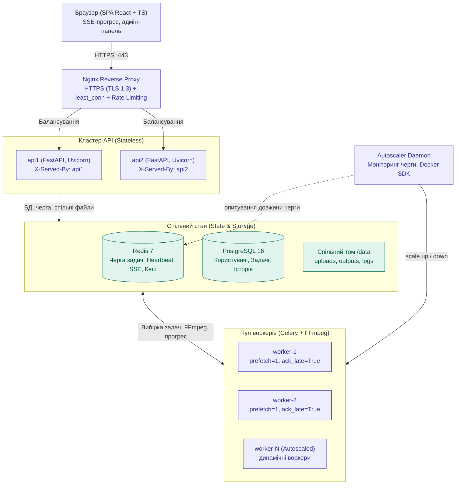

# Cloud Video Processor (CVP)

Розподілений хмарний сервіс пакетної обробки відео із високою доступністю, динамічним автомасштабуванням та моніторингом у реальному часі.

Побудовано на базі **FastAPI**, **Nginx** (балансувальник `least_conn` + HTTPS), **Celery**, **Redis** та **PostgreSQL**. Обробка мультимедіа здійснюється асинхронно через **FFmpeg** із трансляцією живого прогресу в браузер за допомогою **Server-Sent Events (SSE)**.

---

## 📐 Архітектурна схема

Детальний опис компонентів, життєвого циклу задачі та архітектурних рішень наведено у [docs/architecture.md](docs/architecture.md).



---

## 🚀 Запуск однією командою

### 1. Підготовка змінних середовища
```bash
cp .env.example .env
```

### 2. Запуск контейнерів через Docker Compose
```bash
docker compose up --build -d
```

Команда автоматично ініціалізує:
- **`postgres`** — база даних на порту `5432` з healthcheck;
- **`redis`** — брокер черги та стан на порту `6379`;
- **`migrate`** — автоматичне застосування міграцій бази даних через Alembic;
- **`api1`** та **`api2`** — два незалежних бекенд-сервери на базі FastAPI;
- **`worker`** — пул обробників Celery з прив'язкою до спільного тому `/data`;
- **`autoscaler`** — служба автоматичного масштабування воркерів (2..4 контейнери);
- **`nginx`** — балансувальник навантаження, SSL-термінація та роздача React SPA на портах `80` (HTTP) та `443` (HTTPS).

### 3. Доступ до системи
- **Вебінтерфейс (SPA):** [https://localhost](https://localhost)
- **Інтерактивна документація Swagger:** [https://localhost/docs](https://localhost/docs)
- **ReDoc документація:** [https://localhost/redoc](https://localhost/redoc)
- **Облікові дані адміністратора за замовчуванням:**
  - **Email:** `admin@example.com`
  - **Пароль:** `admin_password_123`

---

## ⚙️ Змінні конфігурації `.env`

| Змінна | Тип | За замовчуванням | Опис |
| :--- | :---: | :---: | :--- |
| **`DB_USER`** | `str` | `cvp` | Ім'я користувача PostgreSQL |
| **`DB_PASSWORD`** | `str` | `my_secret_password` | Пароль до бази даних PostgreSQL |
| **`DB_NAME`** | `str` | `cvp` | Назва бази даних |
| **`DB_HOST`** | `str` | `postgres` | Хост сервера бази даних |
| **`DB_PORT`** | `int` | `5432` | Порт сервера бази даних |
| **`REDIS_HOST`** | `str` | `redis` | Хост сервера Redis |
| **`REDIS_PORT`** | `int` | `6379` | Порт сервера Redis |
| **`REDIS_DB`** | `int` | `0` | Номер бази даних Redis |
| **`JWT_SECRET`** | `str` | `super_secure_jwt_...` | Секретний ключ для підпису JWT токенів |
| **`JWT_ALGORITHM`** | `str` | `HS256` | Алгоритм шифрування токенів |
| **`JWT_EXPIRE_MINUTES`** | `int` | `60` | Термін дії сесійного токена у хвилинах |
| **`COOKIE_SECURE`** | `bool` | `true` | Прапорець Secure для cookie токена |
| **`COOKIE_SAMESITE`** | `str` | `lax` | Політика SameSite для сесійних cookie |
| **`ADMIN_EMAIL`** | `str` | `admin@example.com` | Email системного адміністратора (створюється при старті) |
| **`ADMIN_PASSWORD`** | `str` | `admin_password_123` | Пароль облікового запису адміністратора |
| **`MAX_FILE_MB`** | `int` | `100` | Максимальний розмір відеофайлу у МБ |
| **`MAX_DURATION_SEC`** | `int` | `120` | Максимальна тривалість відеофайлу у секундах |
| **`MAX_ACTIVE_TASKS`** | `int` | `5` | Ліміт активних задач на одного користувача (`queued` + `running`) |
| **`MAX_HISTORY`** | `int` | `20` | Максимальна кількість збережених задач користувача в історії |
| **`MAX_QUEUE`** | `int` | `100` | Максимальна місткість глобальної черги сервера |
| **`RESULT_LIFETIME_HOURS`** | `int` | `24` | Термін зберігання обробленого результату на диску (годин) |
| **`MIN_WORKERS`** | `int` | `2` | Мінімальна кількість воркерів під час масштабування |
| **`MAX_WORKERS`** | `int` | `4` | Максимальна кількість воркерів під час масштабування |
| **`PER_WORKER`** | `int` | `2` | Поріг навантаження (кількість задач у черзі на 1 воркер) |
| **`IDLE_FOR`** | `int` | `60` | Час простою додаткового воркера без задач до видалення (секунд) |

---

## 🛡️ Системні ліміти та поведінка системи

| Ліміт | Значення | Перевірка | Поведінка при перевищенні |
| :--- | :---: | :--- | :--- |
| **Розмір файлу** | 100 МБ | Стрімінговий підрахунок байтів при завантаженні | `422 Unprocessable Content`, переривання з'єднання, видалення часткового файлу |
| **Тривалість відео** | 120 с | Аналіз через `ffprobe` | `422 Unprocessable Content`, видалення завантаженого файлу |
| **Роздільна здатність** | 1920×1080 | Аналіз ширини та висоти відеопотоку `ffprobe` | `422 Unprocessable Content`, видалення завантаженого файлу |
| **Формати відео** | mov, mp4, mkv, webm, avi | Валідація контейнера та наявності відеопотоку | `422 Unprocessable Content`, видалення завантаженого файлу |
| **Активні задачі** | <= 5 на користувача | Підрахунок задач зі статусом `queued` + `running` | `429 Too Many Requests` з чітким повідомленням |
| **Глобальна черга** | <= 100 задач | Підрахунок задач у черзі кластера | `503 Service Unavailable` із заголовком `Retry-After: 30` |
| **Історія задач** | <= 20 на користувача | Перевірка при додаванні нової задачі | Автоматичне видалення найстаріших завершених задач разом із файлами |
| **Дисковий простір** | >= 50 МБ вільного місця | `shutil.disk_usage` перед записом та у воркері | `507 Insufficient Storage` (в API) або статус `failed` (у воркері) |
| **Час життя файлу** | 24 години | Фонове прибирання кожні 10 хв за полем `expires_at` | Автоматичне видалення файлів та очищення запису з бази даних |

---

## 📋 Таблиця «Вимога → Реалізація»

| № | Вимога технічного завдання / КТ | Реалізація у кодовій базі | Файли реалізації |
| :-: | :--- | :--- | :--- |
| **КТ1** | Балансувальник навантаження, HTTPS, `least_conn`, `X-Served-By` | Nginx зворотний проксі, mkcert TLS сертифікати, заголовок `X-Served-By` у middleware FastAPI, 2 сервери `api1` та `api2` | [`nginx/nginx.conf`](nginx/nginx.conf), [`backend/app/main.py`](backend/app/main.py) |
| **п. 1** | Завантаження та валідація відео | Стрімінгове збереження шматками, `probe_video` через ffprobe, валідація тривалості, розміру, потоків, лімітів | [`backend/app/routers/tasks.py`](backend/app/routers/tasks.py), [`backend/app/services/probe.py`](backend/app/services/probe.py) |
| **КТ2** | Черга та асинхронні воркери, FFmpeg | Celery worker (`--concurrency=1`, `worker_prefetch_multiplier=1`, `task_acks_late=True`), спільний том `/data`, запуск FFmpeg із перехопленням прогресу | [`backend/worker/tasks.py`](backend/worker/tasks.py), [`backend/worker/app.py`](backend/worker/app.py) |
| **п. 2** | Операції обробки відео | Конвертація у MP4 (H.264+AAC), масштабування (1080p..360p з CRF), водяний знак PNG з прозорістю, вилучення аудіо у MP3 / mute | [`backend/worker/tasks.py`](backend/worker/tasks.py) |
| **п. 3** | Скасування задачі | Прапорець `cancel:{task_id}` у Redis, кооперативне скасування у воркері через `proc.terminate()`, очищення незавершеного файлу | [`backend/app/routers/tasks.py`](backend/app/routers/tasks.py), [`backend/worker/tasks.py`](backend/worker/tasks.py) |
| **п. 4** | Відстеження прогресу (SSE) | Ендпоінт `GET /api/tasks/{id}/events` передає поточний статус і відсоток (0..100) з Redis раз на 1 секунду | [`backend/app/routers/tasks.py`](backend/app/routers/tasks.py) |
| **КТ3** | Вебінтерфейс користувача | React 18, TypeScript, адаптивний темний UI, EventSource слухач, перегляд результату через `<video controls>`, керування задачами | [`frontend/src/App.tsx`](frontend/src/App.tsx), [`frontend/src/pages/TasksPage.tsx`](frontend/src/pages/TasksPage.tsx) |
| **п. 6** | Черга та оцінка часу (ETA) | Розрахунок `queue_position` та `estimate_wait_sec` за тривалістю попередніх задач, залишковим прогресом та активними воркерами | [`backend/app/services/estimation.py`](backend/app/services/estimation.py) |
| **п. 7** | Heartbeat воркерів та Autoscaler | Фоновий потік у воркері пише `hb:{hostname}` у Redis (CPU, RAM, timestamp, TTL 10с); служба `autoscaler` масштабує контейнери за довжиною черги | [`backend/worker/heartbeat.py`](backend/worker/heartbeat.py), [`backend/autoscaler/scaler.py`](backend/autoscaler/scaler.py) |
| **КТ4** | Адмін-панель (`/admin`) | `GET /api/admin/overview`, сторінка моніторингу з опитуванням раз на 3 с, картки статусів, таблиця воркерів з CPU/RAM, останні 50 задач, журнал масштабування, скасування будь-якої задачі | [`backend/app/routers/admin.py`](backend/app/routers/admin.py), [`frontend/src/pages/AdminPage.tsx`](frontend/src/pages/AdminPage.tsx) |
| **п. 8** | Аудит безпеки та стабілізація | Без `shell=True`, `-protocol_whitelist file`, файли виключно як UUID, перевірка власника в усіх ендпоінтах, `limit_req`, HttpOnly Secure cookies | [`backend/worker/tasks.py`](backend/worker/tasks.py), [`backend/app/routers/auth.py`](backend/app/routers/auth.py) |
| **п. 9** | Фонове прибирання | Служба `cleanup_expired_tasks` видаляє застарілі файли та записи з бази раз на 10 хвилин за полем `expires_at` | [`backend/app/services/cleanup.py`](backend/app/services/cleanup.py), [`backend/app/main.py`](backend/app/main.py) |
| **п. 10** | Навантажувальне тестування (Locust) | Сценарій навантаження (реєстрація → вхід → завантаження → опитування), порівняння 2 vs 4 воркери, збереження графіків та CSV | [`locustfile.py`](locustfile.py), [`scripts/benchmark_workers.py`](scripts/benchmark_workers.py), [`docs/evidence/`](docs/evidence/) |

---

## 📡 Опис API (API Reference)

### 1. Автентифікація (`/api/auth`)
- **`POST /api/auth/register`** — реєстрація нового користувача (`email`, `password` від 8 символів). Коди: `201 Created`, `400 Bad Request`.
- **`POST /api/auth/login`** — вхід у систему; встановлює захищену `HttpOnly` cookie `access_token`. Коди: `200 OK`, `401 Unauthorized`.
- **`POST /api/auth/logout`** — вихід із системи та очищення cookie. Коди: `200 OK`.
- **`GET /api/auth/me`** — отримання профілю поточного авторизованого користувача (`id`, `email`, `is_admin`). Коди: `200 OK`, `401 Unauthorized`.

### 2. Керування задачами обробки (`/api/tasks`)
- **`POST /api/tasks`** — завантаження відео (multipart/form-data) та створення задачі:
  - `file`: відеофайл (до 100 МБ, <= 120 с);
  - `operation_type`: `convert` | `scale` | `watermark` | `audio`;
  - `params`: JSON-рядок додаткових параметрів (роздільна здатність, прозорість тощо);
  - `logo`: опційний PNG файл для накладання водяного знака (до 2 МБ).
  - *Коди відповідей:* `201 Created`, `422 Unprocessable Content`, `429 Too Many Requests`, `503 Service Unavailable`, `507 Insufficient Storage`.
- **`GET /api/tasks`** — отримання списку задач поточного користувача. Коди: `200 OK`.
- **`GET /api/tasks/{task_id}`** — деталі задачі з перевіркою власності (статус, прогрес, ETA, черга). Коди: `200 OK`, `403 Forbidden`, `404 Not Found`.
- **`GET /api/tasks/{task_id}/events`** — потік Server-Sent Events (SSE) для відстеження прогресу в реальному часі. Коди: `200 OK` (text/event-stream).
- **`GET /api/tasks/{task_id}/download`** — завантаження готового обробленого медіафайлу (лише для власника або адміна). Коди: `200 OK`, `400 Bad Request`, `404 Not Found`, `410 Gone`.
- **`POST /api/tasks/{task_id}/cancel`** — скасування задачі у черзі або під час обробки. Коди: `200 OK`, `400 Bad Request`, `403 Forbidden`, `404 Not Found`.
- **`DELETE /api/tasks/{task_id}`** — видалення задачі та пов'язаних файлів із диска. Коди: `200 OK`, `404 Not Found`.

### 3. Адміністрування кластера (`/api/admin`, лише для адміністраторів)
- **`GET /api/admin/overview`** — зведені метрики кластера (кількість задач за статусами, довжина черги, активні воркери з CPU/RAM, події масштабування, останні 50 задач). Коди: `200 OK`, `401 Unauthorized`, `403 Forbidden`.
- **`POST /api/admin/tasks/{task_id}/cancel`** — примусове скасування будь-якої активної задачі в кластері адміністратором. Коди: `200 OK`, `403 Forbidden`, `404 Not Found`.
- **`POST /api/admin/cleanup`** — примусовий запуск очищення прострочених задач та файлів з поверненням кількості видалених об'єктів. Коди: `200 OK`.

### 4. Автомасштабування та моніторинг
- **`GET /api/autoscaler/status`** — статус служби автомасштабування та поточна кількість воркерів.
- **`GET /api/autoscaler/events`** — історія подій масштабування (`scale_up`, `scale_down`).
- **`GET /api/health`** — перевірка працездатності екземпляра бекенду із зазначенням `server_id`.

---

## 🧪 Запуск тестів (Pytest)

Проєкт містить вичерпний набір із 57 тестів, що покривають усі 13 днів розробки:
```bash
# Запуск повного тестового набору
pytest backend/tests

# Запуск із детальним звітом
pytest backend/tests -v
```

Покриття тестів включає:
- `test_auth.py` — реєстрація, логін, захист сесій, валідація email та паролів;
- `test_tasks.py` — завантаження файлів, валідація `ffprobe`, перевірка лімітів;
- `test_worker.py` — асинхронні задачі Celery, генерація аргументів FFmpeg, скасування;
- `test_day6.py` — Server-Sent Events (SSE), завантаження результатів, водяні знаки;
- `test_day9.py` — черга, розрахунок позиції та ETA, Retry-After;
- `test_day10.py` — heartbeat воркерів, autoscaler алгоритм, моніторинг ресурсів;
- `test_day11.py` — адмін-ендпоінти, перевірка доступу 401/403, огляд кластера;
- `test_day12.py` — аудит безпеки, protocol whitelist, санітизація UUID, очищення застарілих задач;
- `test_day13.py` — ліміти активних задач та історії, парсинг виводу FFmpeg на тестових рядках, прапорець скасування.

---
