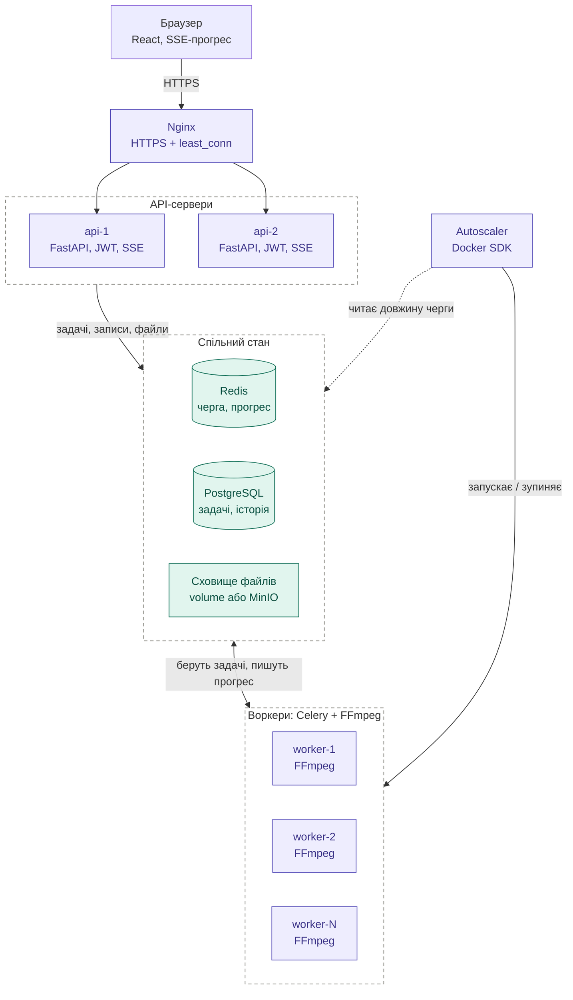

# Архітектура Cloud Video Processor

Хмарний сервіс пакетної обробки відео: користувач завантажує відео, обирає операцію (конвертація, зміна роздільної здатності, водяний знак, робота з аудіо) і бачить хід виконання. Обробка виконується на кількох серверах за балансувальником навантаження.

## Схема

Фіолетовий колір: компоненти застосунку. Бірюзовий: спільний стан. Пунктирна стрілка: Autoscaler лише читає чергу, а не передає задачі.

## Шлях одного відео

1. Браузер завантажує файл через HTTPS на Nginx, який передає запит одному з API-серверів.
2. API перевіряє файл через `ffprobe` (тривалість, розмір, формат), зберігає його у спільне сховище, створює запис у PostgreSQL зі статусом `queued` і ставить задачу в чергу Redis.
3. Вільний воркер бере задачу з Redis, запускає FFmpeg і пише прогрес (0–100%) у Redis.
4. API читає прогрес з Redis і передає його в браузер через SSE.
5. Після завершення воркер зберігає результат у сховище й ставить статус `done` у PostgreSQL.
6. Autoscaler періодично перевіряє довжину черги та запускає або зупиняє контейнери воркерів у межах `MIN_WORKERS` / `MAX_WORKERS`.

## Компоненти

| Компонент | Роль | Технологія |
|-----------|------|-----------|
| Nginx | TLS-термінація, балансування HTTP-запитів, обмеження розміру та частоти запитів | Nginx (`least_conn`) |
| API-сервери | Авторизація, завантаження, валідація, статуси, SSE, історія, адмін-ендпоїнти | Python, FastAPI, Uvicorn |
| Воркери | Виконання задач, запуск FFmpeg, розрахунок прогресу, скасування | Celery, FFmpeg, ffprobe |
| Redis | Черга задач, прогрес, прапорці скасування, heartbeat воркерів | Redis |
| PostgreSQL | Користувачі, задачі, історія | PostgreSQL, SQLAlchemy, Alembic |
| Сховище файлів | Вхідні відео та результати, доступні всім серверам | Docker volume (далі MinIO) |
| Autoscaler | Автоматичний запуск і зупинка воркерів за довжиною черги | Python, Docker SDK |

## Ключові рішення

- **Без станів у серверах.** API-сервери та воркери не зберігають станів у пам'яті: усе лежить у Redis, PostgreSQL і спільному сховищі. Тому Nginx може надіслати запит на будь-який API-сервер, а нові воркери додаються без змін в інших компонентах.
- **Спільне сховище.** Файл, завантажений через api-1, має бути доступний воркеру на будь-якому вузлі та API-серверу api-2 для скачування результату.
- **Два рівні балансування.** Nginx розподіляє HTTP-запити між API-серверами, а важкі задачі розподіляються чергою: вільний воркер сам бере наступну задачу.
- **Скасування задачі.** API ставить прапорець у Redis, воркер у циклі читання прогресу бачить його, зупиняє FFmpeg (SIGTERM, потім SIGKILL), видаляє частковий файл і ставить статус `cancelled`.
- **Час очікування в черзі.** `ETA = (сумарна тривалість відео перед вашим + залишок поточних) / (швидкість обробки × кількість воркерів)`, де швидкість це секунди відео за секунду роботи.
- **Моніторинг для адмін-панелі.** Кожен воркер раз на 2–3 секунди пише heartbeat (ім'я, CPU, RAM, поточна задача) у Redis з TTL 10 с. Зникнення запису означає, що воркер не працює.
