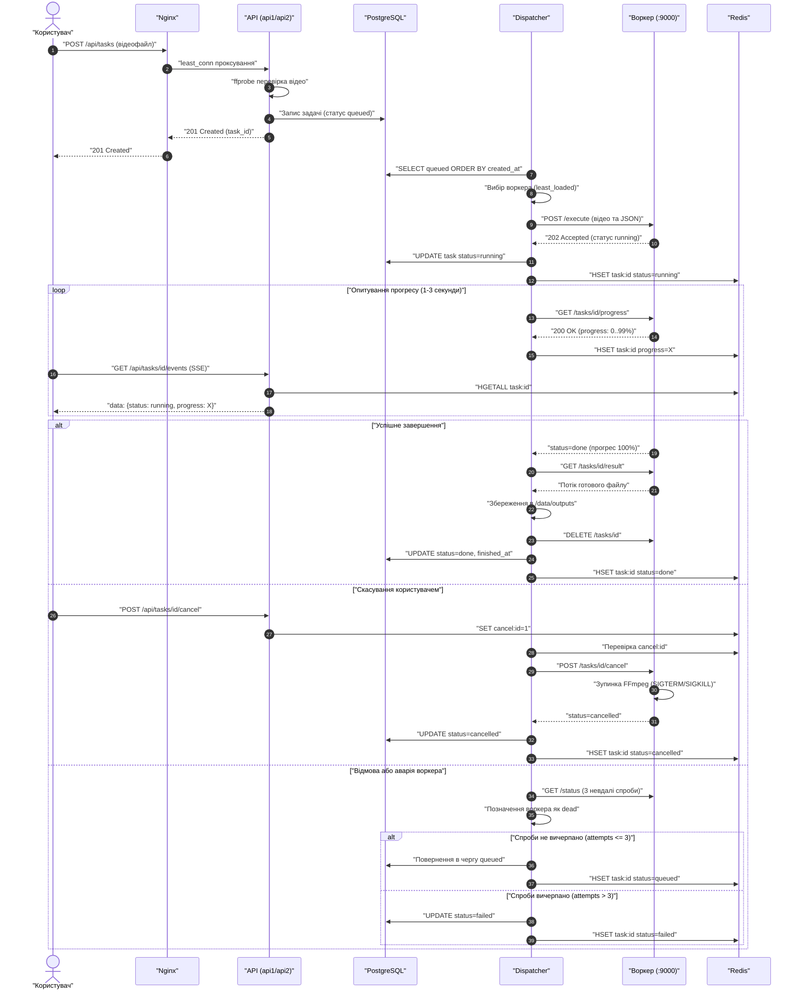
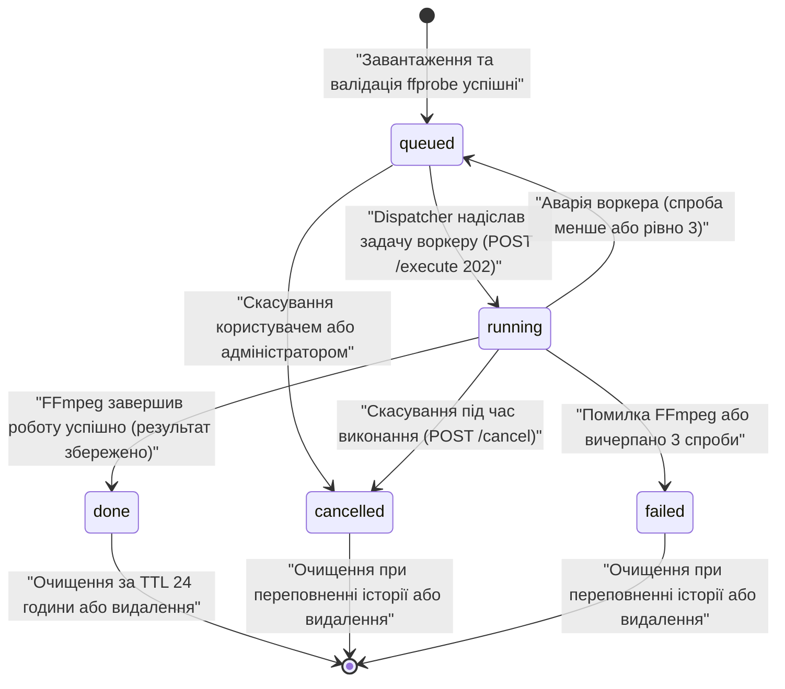

# Архітектура Cloud Video Processor (CVP)

Розподілений хмарний сервіс пакетної обробки відео: користувач завантажує відео, обирає операцію (конвертація, зміна роздільної здатності, водяний знак, вилучення або приглушення аудіо) і спостерігає за ходом виконання в реальному часі через Server-Sent Events (SSE).

Система побудована за розподіленою сервісною архітектурою з двома незалежними рівнями балансування навантаження, повною мережевою ізоляцією обчислювальних воркерів та автоматичним масштабуванням.

---

## 1. Огляд архітектури системи

```mermaid
flowchart TB
    subgraph CLIENT["Клієнтський рівень"]
        Browser["Браузер React 19, TypeScript"]
    end

    subgraph PROXY["Рівень маршрутизації"]
        Nginx["Nginx Reverse Proxy TLS 1.2 і 1.3"]
    end

    subgraph API_CLUSTER["Кластер API Stateless"]
        API1["api1 FastAPI, Uvicorn"]
        API2["api2 FastAPI, Uvicorn"]
    end

    subgraph CORE_STATE["Спільний стан Лише API та Dispatcher"]
        PG[("PostgreSQL 16 Черга queued та задачі")]
        Redis[("Redis 7 Прогрес, скасування, логи")]
        Storage["Спільний том data uploads та outputs"]
    end

    subgraph DISPATCHER_LAYER["Рівень диспетчеризації"]
        Dispatcher["Dispatcher Daemon 1 екземпляр"]
    end

    subgraph WORKER_POOL["Ізольовані HTTP-воркери порт 9000"]
        W1["worker-1 FastAPI та FFmpeg"]
        W2["worker-2 FastAPI та FFmpeg"]
        WN["worker-remote Віддалена машина"]
    end

    subgraph AUTOSCALING["Рівень автомасштабування"]
        Autoscaler["Autoscaler Daemon Docker SDK"]
    end

    Browser -->|"HTTPS запити порт 443"| Nginx
    Nginx -->|"Балансування least_conn"| API1
    Nginx -->|"Балансування least_conn"| API2

    API1 -->|"Створення queued задач"| PG
    API2 -->|"Створення queued задач"| PG
    API1 -->|"Збереження uploads"| Storage
    API2 -->|"Збереження uploads"| Storage
    API1 -->|"Читання прогресу task:id"| Redis
    API2 -->|"Читання прогресу task:id"| Redis

    Dispatcher -->|"Опитування черги queued"| PG
    Dispatcher -->|"Читання uploads та запис outputs"| Storage
    Dispatcher -->|"Оновлення прогресу та логи"| Redis

    Dispatcher -->|"HTTP POST /execute стрімінг файлу"| W1
    Dispatcher -->|"HTTP POST /execute стрімінг файлу"| W2
    Dispatcher -->|"HTTP POST /execute стрімінг файлу"| WN

    W1 -->|"HTTP GET progress та result"| Dispatcher
    W2 -->|"HTTP GET progress та result"| Dispatcher
    WN -->|"HTTP GET progress та result"| Dispatcher

    W1 -.->|"Самореєстрація та heartbeat"| Dispatcher
    W2 -.->|"Самореєстрація та heartbeat"| Dispatcher
    WN -.->|"Самореєстрація та heartbeat"| Dispatcher

    Autoscaler -.->|"Опитування кількості queued"| PG
    Autoscaler -->|"Масштабування контейнерів воркерів"| WORKER_POOL

    classDef app fill:#EEEDFE,stroke:#534AB7,color:#3C3489
    classDef state fill:#E1F5EE,stroke:#0F6E56,color:#085041
    class Browser,Nginx,API1,API2,Dispatcher,W1,W2,WN,Autoscaler app
    class PG,Redis,Storage state
```

> **Легенда кольорів та зв'язків:**
> - 🟣 **Фіолетові блоки (app):** активні сервіси застосунку (Nginx, API-сервери, Dispatcher, Worker Server, Autoscaler).
> - 🟢 **Бірюзові блоки (state):** сховища стану (PostgreSQL, Redis, том `/data`), доступні **виключно** для API та Dispatcher.
> - **Суцільні стрілки:** клієнтські HTTPS-запити, передача даних та мережевий стрімінг файлів через HTTP POST/GET.
> - **Пунктирні стрілки:** службові сигнали (самореєстрація, фоновий heartbeat, періодичне опитування стану черги).

---

## 2. Життєвий цикл задачі

---

## 3. Статуси та переходи станів задачі

---

## 4. Детальний опис компонентів системи

### 4.1 Nginx (Зворотний проксі та Ingress)
- **Термінація TLS:** підтримує протоколи `TLSv1.2` та `TLSv1.3` на порту `443` із шифрами `HIGH:!aNULL:!MD5`. Запити на порт `80` автоматично перенаправляються через `301 Moved Permanently`.
- **Балансування HTTP API:** директива `upstream backend_servers` використовує алгоритм `least_conn` для розподілу запитів між `api1:8000` та `api2:8000`. Параметри `max_fails=3 fail_timeout=10s` та `proxy_next_upstream` гарантують прозоре перенаправлення запитів у разі аварії одного з API-серверів.
- **Обмеження частоти запитів:** зона пам'яті `limit_req_zone $binary_remote_addr zone=auth_limit:10m rate=5r/s` з `burst=10 nodelay` на маршрутах `/api/auth/` захищає від атак типу брутфорс (повертає HTTP `429 Too Many Requests`).
- **Спеціальні налаштування для SSE:** на шляху `/api/` вимкнено буферизацію (`proxy_buffering off; chunked_transfer_encoding off; proxy_read_timeout 3600s;`), що дозволяє транслювати Server-Sent Events без затримок.
- **Статичний фронтенд:** каталог `/usr/share/nginx/html` роздає зібраний React SPA (`frontend/dist`) із маршрутизацією `try_files $uri $uri/ /index.html`.

### 4.2 Stateless API-кластер (`api1`, `api2`)
- **Технологія:** FastAPI на базі Python 3.12-slim та сервера ASGI Uvicorn.
- **Stateless-архітектура:** сесії не зберігаються у пам'яті серверів. Ідентифікація виконується через криптографічний JWT-токен у захищеному cookie (`access_token`, прапорці `HttpOnly`, `Secure`, `SameSite=Lax`).
- **Заголовок `X-Served-By`:** кожен екземпляр повертає заголовок із власним ідентифікатором (`SERVER_ID=api1` або `SERVER_ID=api2`), що дозволяє перевірити балансування Nginx.
- **Приймання та валідація відео:** потокове читання з обмеженням розміру (до 100 МБ), збереження у `/data/uploads/{task_id}{safe_ext}` та обов'язкова верифікація через `ffprobe` (тривалість <= 120 с, роздільна здатність <= 1080p, наявність відеопотоку).
- **Робота з чергою:** API **не виконує** кодування відео і **не звертається** до воркерів напряму. Задача записується у PostgreSQL зі статусом `queued`. Чергою є виключно таблиця `tasks` у PostgreSQL.
- **SSE-прогрес:** ендпоінт `GET /api/tasks/{task_id}/events` щосекунди читає швидкий стан із Redis (хеш `task:{task_id}`) і транслює події в браузер клієнта.

### 4.3 Спільний стан (PostgreSQL, Redis, том `/data`)
- **PostgreSQL 16:** реляційна база даних. Зберігає сутності користувачів (`users`) та повну історію задач (`tasks`). Черга не зберігається в пам'яті, а формується записами зі статусом `queued`, впорядкованими за `created_at`.
- **Redis 7:** оперативне сховище швидкого стану в оперативній пам'яті:
  - `task:{task_id}` — хеш з оперативними полями: `status`, `progress`, `worker_id`, `started_at`, `finished_at`, `output_file`, `error`, `attempts`.
  - `cancel:{task_id}` — прапорець запиту на скасування активної задачі (TTL 3600 с).
  - `hb:{worker_id}` — хеш метрик життєздатності воркера (CPU, RAM, активні задачі, мітка часу, TTL 10 с).
  - `dispatcher:log` — циклічний список останніх 100 подій розподілу задач.
  - `autoscaler:log` — циклічний список останніх 100 подій масштабування контейнерів.
- **Спільний том `/data`:** монтується **лише** до API та Dispatcher. Містить директорії `uploads/`, `outputs/` та `logs/`. Воркери до цього тому доступу не мають.

### 4.4 Координатор Dispatcher
- **Технологія:** окремий незалежний демон на FastAPI / asyncio, що працює в єдиному екземплярі на внутрішньому порту `8100`.
- **Цикл диспетчеризації (`dispatch_cycle`):** щосекунди робить вибірку `queued` задач із PostgreSQL, знаходить вільних зареєстрованих воркерів і за обраною стратегією (`least_loaded` або `round_robin`) надсилає задачу на воркер запитом `POST /execute` разом із потоковою передачею вхідного відеофайлу.
- **Цикл моніторингу (`monitor_cycle`):** щосекунди опитує стан активних задач через `GET /tasks/{task_id}/progress`, синхронізує відсоток виконання в Redis (хеш `task:{task_id}`) та перевіряє запити на скасування.
- **Завантаження результату:** після отримання статусу `done` Dispatcher викачує готовий файл через `GET /tasks/{task_id}/result` у каталог `/data/outputs/`, надсилає воркеру запит `DELETE /tasks/{task_id}` для звільнення його диска та оновлює статус у PostgreSQL на `done`.
- **Відмовостійкість і Restart Recovery:**
  - Якщо воркер не відповідає 3 рази поспіль (`WORKER_FAIL_THRESHOLD=3`), Dispatcher маркує його як `dead` і повертає задачі назад у чергу `queued` зі збільшенням лічильника `attempts`. Якщо кількість спроб перевищує `MAX_TASK_ATTEMPTS=3`, задача фіксується як `failed`.
  - При власному перезапуску Dispatcher автоматично знаходить у PostgreSQL задачі зі статусом `running` і переводить їх у `queued` (`recover_running_tasks_sync`).

### 4.5 Автономні Worker-сервери (Worker Server)
- **Технологія:** автономний сервіс на базі FastAPI, Uvicorn та процесу FFmpeg на порту `9000`.
- **Повна ізоляція (Zero-Trust):** воркер не має підключення до PostgreSQL, Redis чи спільного тому `/data`. Він може виконуватися на віддаленій машині в іншій мережі.
- **Авторизація:** усі виклики (крім `GET /health`) вимагають спільний секретний заголовок `X-Worker-Token`.
- **Локальний диск:** відео зберігається у локальній тимчасовій директорії (`WORKER_DATA_DIR`, наприклад `/tmp/cvp-worker`).
- **FFmpeg Runner:** кодування запускається в окремому потоці ОС (`threading.Thread`). Аргументи формуються суворо списком без `shell=True`, використовується директива безпеки `-protocol_whitelist file`, пресети обмежуються білим списком `ALLOWED_PRESETS`, а максимальний час виконання обмежується `TASK_TIMEOUT_SEC` (300 с).
- **Самореєстрація:** при старті воркер надсилає `POST /internal/workers/register` на координатор Dispatcher та повторює його кожні 10 секунд. При коректній зупинці надсилається `POST /internal/workers/deregister`.

### 4.6 Демон автомасштабування (Autoscaler)
- **Технологія:** фоновий процес на Python, що взаємодіє з Docker Engine через сокет `/var/run/docker.sock`.
- **Алгоритм масштабування:**
  - Кожні 5 секунд підраховує кількість `queued` задач у PostgreSQL.
  - Якщо `queued > n * PER_WORKER` (де `n` — кількість поточних воркерів) і `n < MAX_WORKERS`, запускається новий контейнер воркера з мітками `cvp.role=worker` та `cvp.autoscaled=1`.
  - Якщо черга порожня (`queued == 0`), воркери, що перебувають у стані простою довше ніж `IDLE_FOR` секунд, автоматично зупиняються та видаляються (до нижньої межі `MIN_WORKERS`).
  - Усі дії фіксуються в списку Redis `autoscaler:log`.

---

## 5. Порівняння архітектури: HTTP Push (Dispatcher) проти черги брокера (Celery)

| Критерій | Поточна реалізація: Dispatcher (HTTP Push) | Попередня реалізація: Celery (Broker Pull) |
| :--- | :--- | :--- |
| **Мережева модель** | Push: координатор Dispatcher сам обирає воркера й надсилає йому задачу | Pull: воркери самостійно витягують задачі з черги Redis |
| **Ізоляція воркерів** | **Повна:** воркер не має доступу до БД, Redis чи томів хоста | **Відсутня:** воркери мають повний доступ до Redis та спільної ФС |
| **Спільний том /data** | Потрібен **лише** для API та Dispatcher | Обов'язковий для всіх воркерів (проблема NFS/мережевих томів) |
| **Віддалені воркери** | Легко запускаються на окремому ПК або GPU-сервері через порт 8100 | Складно: вимагає розгортання спільної мережевої файлової системи |
| **Балансування** | Розумне: `least_loaded` на основі місткості, CPU та активних задач | Просте: за наявністю повідомлень у черзі брокера |
| **Перезапуск при аварії** | Координатор детектує збій воркера та автоматично повертає задачу в чергу | Спиралося на механізм `acks_late` у брокері повідомлень |
