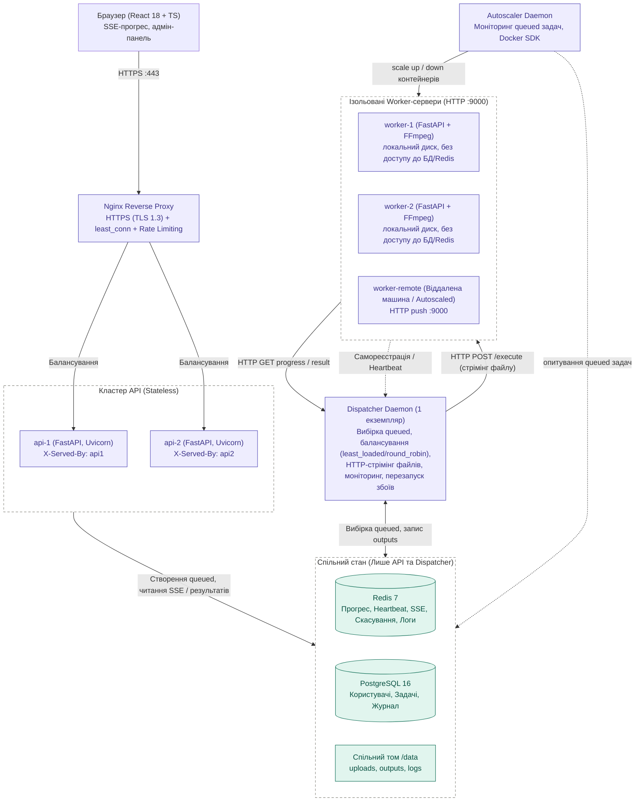

# Архітектура Cloud Video Processor

Хмарний сервіс пакетної обробки відео: користувач завантажує відео, обирає операцію (конвертація, зміна роздільної здатності, водяний знак, робота з аудіо) і бачить хід виконання у реальному часі. Система спроєктована за розподіленою архітектурою з балансуванням навантаження на двох рівнях (HTTP API та задачі обробки FFmpeg), високою доступністю та динамічним автомасштабуванням.

---

## 📐 Архітектурна схема

> **Кольорове позначення:**
> - 🟣 **Фіолетовий:** сервіси застосунку (Nginx, API-сервери, Dispatcher, Worker-сервери, Autoscaler).
> - 🟢 **Бірюзовий:** спільний стан та сховище (PostgreSQL, Redis, том `/data`), доступні **виключно** API та Dispatcher.
> - **Пунктир:** фоновий моніторинг черги та сервісні сигнали самореєстрації.

---

## 🎬 Шлях одного відео

1. **Завантаження та валідація:** Користувач у вебінтерфейсі надсилає відеофайл на захищений HTTPS-ендпоінт Nginx. Nginx передає запит одному з екземплярів API (`api1` або `api2`) згідно зі стратегією `least_conn`.
2. **Перевірка та черга:** API потоково зберігає файл у `/data/uploads/{task_id}_input{ext}`, перевіряє ліміти через `ffprobe` (тривалість <= 120 с, розмір <= 100 МБ, роздільна здатність <= 1080p, валідний відеопотік), створює запис у PostgreSQL зі статусом `queued` та повертає клієнту `201 Created`. API **не відправляє** задачу напряму на обробку, залишаючи її в статусі `queued`.
3. **Диспетчеризація (Dispatch Cycle):** Служба `Dispatcher` (працює в єдиному екземплярі) раз на секунду опитує базу даних щодо наявності задач зі статусом `queued`, відсортованих за часом створення (`created_at`).
4. **Вибір воркера:** Dispatcher перевіряє наявність вільних слотів серед зареєстрованих живих воркерів (`alive`). За обраною стратегією (`least_loaded` або `round_robin`) обирається найкращий кандидат.
5. **Мережева передача (Push):** Dispatcher потоково зчитує вхідний файл із `/data/uploads` і надсилає його на обраний воркер через HTTP `POST /execute` (multipart/form-data разом із параметрами та опційним логотипом). Якщо запит успішний, статус задачі в БД змінюється на `running`, а воркер починає обробку.
6. **Ізольована обробка FFmpeg:** Воркер зберігає файл на свій локальний ізольований диск (наприклад, у `/tmp/cvp-worker/tasks/{task_id}/input.mp4`) і запускає процес FFmpeg в окремому потоці виконання (`asyncio.to_thread`). Прогрес виконання обчислюється локально в пам'яті воркера без звернень до зовнішніх баз.
7. **Моніторинг прогресу:** Dispatcher періодично опитує воркер через `GET /tasks/{task_id}/progress`, оновлює прогрес (0..99%) у Redis (`progress:{task_id}`) та базі даних. Клієнтський браузер отримує оновлення в реальному часі через Server-Sent Events (SSE) з API-сервера.
8. **Отримання результату:** Коли воркер повертає статус `done`, Dispatcher потоково викачує готовий файл через `GET /tasks/{task_id}/result` і зберігає його у `/data/outputs/{task_id}_output{ext}`. Після успішного збереження Dispatcher надсилає воркеру `DELETE /tasks/{task_id}` для звільнення локального дискового простору та переводить статус задачі в базі на `done` (прогрес 100%).
9. **Скасування задачі:** Якщо користувач або адміністратор натискає «Скасувати», API виставляє прапорець `cancel:{task_id}` у Redis. Dispatcher під час чергового опитування виявляє скасування та надсилає воркеру `POST /tasks/{task_id}/cancel`. Воркер виставляє локальний `threading.Event`, перериває процес FFmpeg (`SIGTERM` -> `SIGKILL`), очищає файли та фіксує статус `cancelled`.
10. **Автомасштабування:** Служба `Autoscaler` моніторить кількість `queued` задач у базі та за потреби динамічно створює або зупиняє додаткові Docker-контейнери воркерів (у діапазоні від 2 до 4 екземплярів).

---

## 🧩 Компоненти системи

| Компонент | Роль у системі | Технологічний стек |
| :--- | :--- | :--- |
| **Nginx** | Зворотний проксі, TLS-термінація (HTTPS), балансування запитів до API (`least_conn`), обмеження частоти запитів (`limit_req`) та роздача клієнтського React SPA | Nginx, TLS 1.3 |
| **API-сервери (`api1`, `api2`)** | Авторизація користувачів (JWT у `HttpOnly` cookie), валідація завантажень (`ffprobe`), трансляція SSE-подій, віддача готових результатів, адмін-панель | Python 3.13, FastAPI, Uvicorn |
| **Dispatcher** | Єдиний координатор черги: вибірка `queued` задач, балансування навантаження, HTTP-стрімінг медіа на воркери, моніторинг прогресу, завантаження результатів, авто-перезапуск задач при аваріях воркерів | Python 3.13, FastAPI, HTTPX, SQLAlchemy, Redis |
| **Worker-сервери (`worker`)** | Автономні вузли обробки: приймають задачі по HTTP, виконують перекодування FFmpeg на локальному диску, віддають прогрес і готовий файл. Повністю ізольовані від БД, Redis і спільного диска | Python 3.13, FastAPI, Uvicorn, FFmpeg, psutil |
| **Redis** | Оперативне сховище швидкого стану: прогрес виконання (0..100%), прапорці скасування, heartbeat воркерів, черга подій Dispatcher log | Redis 7 |
| **PostgreSQL** | Надійне реляційне сховище: облікові записи користувачів, задачі, історія обробок | PostgreSQL 16, SQLAlchemy, Alembic |
| **Спільний том `/data`** | Файлове сховище вхідних та вихідних відео. Доступне **виключно** API-серверам та Dispatcher | Docker Volume / Local FS (MinIO-ready) |
| **Autoscaler** | Демон автомасштабування: підраховує довжину черги `queued` і керує життєвим циклом контейнерів воркерів | Python 3.13, Docker SDK |

---

## 🔄 Мережевий протокол взаємодії: Dispatcher ↔ Worker Server

Взаємодія між координатором та воркерами відбувається виключно через протокол HTTP/REST. Усі ендпоінти (крім `/health`) захищені спільним токеном у заголовку `X-Worker-Token`.

### Ендпоінти Worker Server (порт 9000):
- **`POST /execute`** — передача задачі та вхідного відеофайлу (multipart/form-data):
  - Поля: `task_id`, `operation_type`, `params` (JSON-рядок), `duration_sec`, `file` (відеопотік), `logo` (опційний PNG).
  - Ідемпотентність: якщо `task_id` вже відомий, повертається `200 OK` з поточним станом без повторного запуску.
  - Ліміти: повертає `503 Service Unavailable`, якщо активних задач >= `WORKER_CAPACITY`; повертає `507 Insufficient Storage`, якщо вільного місця на локальному диску < 50 МБ.
  - Успішна відповідь: `202 Accepted`.
- **`GET /tasks/{task_id}/progress`** — стан виконання задачі:
  - Повертає: `{task_id, status: running|done|failed|cancelled, progress: 0..99, error, started_at, finished_at}`.
  - Код `404 Not Found`, якщо задача невідома воркеру.
- **`POST /tasks/{task_id}/cancel`** — виставлення прапорця скасування:
  - Ідемпотентно активує внутрішній `threading.Event`, що призводить до зупинки процесу FFmpeg (`SIGTERM` -> `SIGKILL`) та видалення часткових файлів.
- **`GET /tasks/{task_id}/result`** — завантаження готового медіафайлу:
  - Повертає `FileResponse` зі стримінгом, лише якщо `status == "done"`. Інакше повертає `409 Conflict`.
- **`DELETE /tasks/{task_id}`** — очищення локальних ресурсів:
  - Ідемпотентно видаляє вхідні та вихідні файли задачі з локального диска воркера та видаляє запис задачі з пам'яті.
- **`GET /status`** — метрики стану воркера:
  - Повертає: `{worker_id, url, capacity, active_tasks, active_task_ids, cpu_percent, ram_percent, uptime_sec}`.
- **`GET /health`** — перевірка працездатності:
  - Повертає: `{"status": "ok"}` (не вимагає авторизаційного токена).

### Самореєстрація воркерів у Dispatcher (порт 8100):
- **`POST /internal/workers/register`** — реєстрація або періодичний heartbeat:
  - Тіло: `{worker_id, url, capacity}`.
  - Воркер автоматично надсилає цей запит при старті (з повторними спробами) та кожні 10 секунд під час роботи.
- **`POST /internal/workers/deregister`** — вихід воркера:
  - Надсилається воркером перед завершенням роботи (graceful shutdown) для негайного вилучення з пулу доступних виконавців.

---

## 💡 Переваги нової архітектури

1. **Повна ізоляція та нульова довіра (Zero-Trust Worker):**
   Воркер-сервери не мають доступу до бази даних PostgreSQL, сховища Redis чи спільних дисків із конфіденційними даними інших користувачів. Навіть компрометація воркера не загрожує цілісності реляційної БД чи сесій користувачів.
2. **Можливість запуску віддалених воркерів (Remote Workers):**
   Воркери можуть розміщуватися на будь-яких фізичних серверах, віртуальних машинах чи потужних GPU-інстансах у хмарі (AWS EC2, Hetzner тощо). Для підключення воркеру достатньо мати мережевий доступ до порту `8100` сервісу Dispatcher.
3. **Керована диспетчеризація навантаження:**
   На відміну від некерованої черги брокера (де воркери самі витягують задачі), координатор Dispatcher володіє повною картиною стану всього кластера: завантаженням CPU/RAM, активними задачами та доступними слотами кожного воркера, реалізуючи розумні стратегії балансування (`least_loaded`, `round_robin`).
4. **Автоматичне відновлення після аварій (Self-Healing):**
   Якщо воркер раптово падає або втрачає зв'язок (3 невдалі опитування поспіль), Dispatcher автоматично фіксує статус `dead`, відкликає задачу та повертає її в чергу `queued` для виконання іншим здоровим воркером (до `MAX_TASK_ATTEMPTS` спроб).
