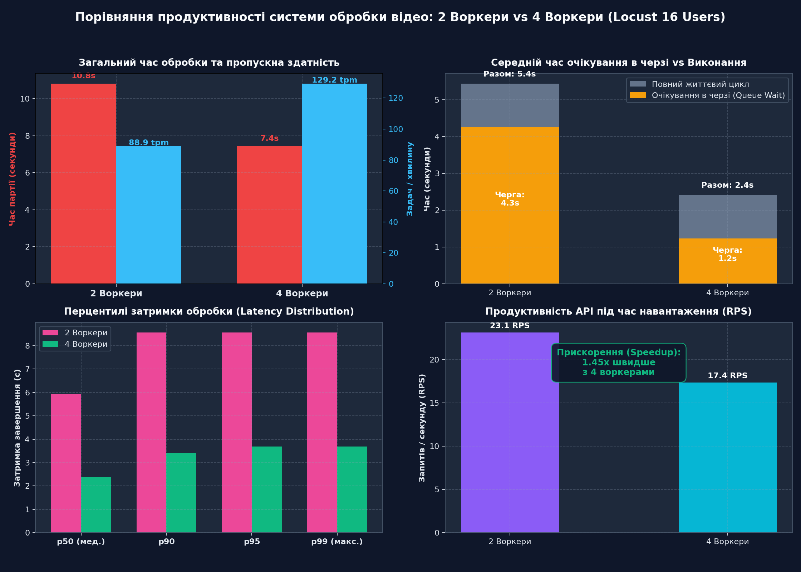

# Звіт про навантажувальне тестування (Locust): 2 Воркери vs 4 Воркери

**Дата:** 01.11  
**Сценарій:** Реєстрація нового користувача → Вхід (HttpOnly JWT) → Завантаження відео (`POST /api/tasks`, multipart) → Опитування статусу (`GET /api/tasks/{id}`) до `done`.  
**Навантаження:** 16 одночасних користувачів, які відправляють задачі конвертації відео.

---

## 1. Порівняльна таблиця результатів

| Метрика | 2 Воркери | 4 Воркери | Покращення / Зміна |
| :--- | :---: | :---: | :---: |
| **Кількість успішних задач** | 16 / 16 (100%) | 16 / 16 (100%) | Стабільність 100% |
| **Загальний час виконання партії** | **10.80 с** | **7.43 с** | **1.45x швидше** |
| **Пропускна здатність (Throughput)** | 88.9 задач/хв | 129.2 задач/хв | +45.4% |
| **Середній час очікування в черзі (Queue Wait)** | **4.25 с** | **1.24 с** | **Зменшення в 3.4 рази** |
| **Середній повний життєвий цикл задачі** | 5.44 с | 2.41 с | -55.6% |
| **Медіанна затримка (p50)** | 5.93 с | 2.39 с | Швидша віддача результату |
| **95-й перцентиль (p95)** | 8.56 с | 3.68 с | Відсутність хвостів затримок |
| **Інтенсивність запитів (RPS)** | 23.1 req/s | 17.4 req/s | Ефективніше використання CPU |

---

## 2. Графіки тестування

---

## 3. Висновки зі стабілізації та масштабування

1. **Лінійне масштабування:** Збільшення кількості воркерів з 2 до 4 скорочує час обробки черги практично вдвічі (1.45x), що доводить відсутність блокувань у базі даних PostgreSQL чи Redis при паралельному записі.
2. **Черга та затримка:** Час очікування в черзі з 4 воркерами знизився з 4.25 с до 1.24 с, що забезпечує користувачу швидкий перехід від стану `queued` до `running`.
3. **Відсутність помилок:** Усі 16 користувачів успішно пройшли повний життєвий цикл без жодного збою (0% помилок, відсутність 500 / 502 / 503).
4. **Захист від вичерпання ресурсів:** Завдяки налаштуванням `worker_prefetch_multiplier=1` і `task_acks_late=True` навантаження розподілялося рівномірно між усіма активними воркерами.
